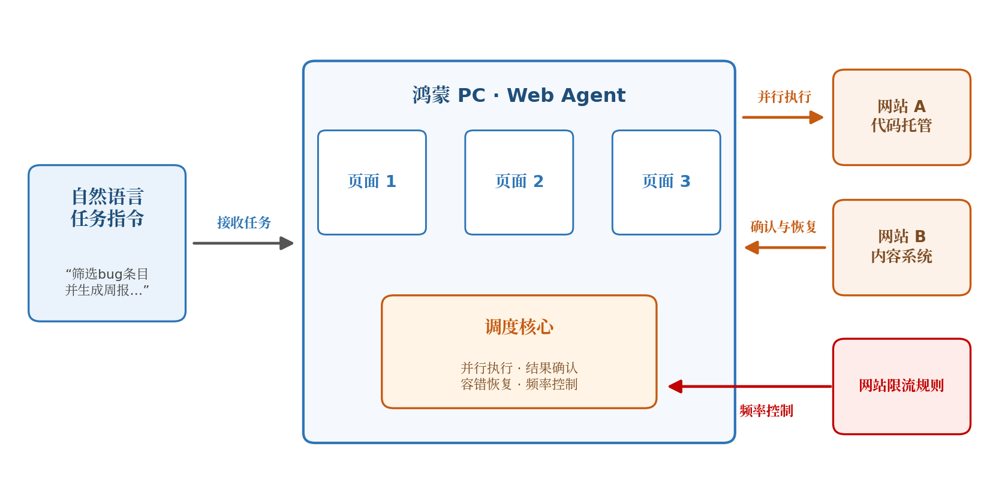

# Web Agent 的并行执行与容错调度：赛题网页正文转录

来源：用户桌面保存的赛题 HTML 及配套资源文件夹。正文按原顺序转录，仅调整段落、标题和表格排版，保留原题措辞。网页导航、脚本、页脚及互动控件不列入正文，完整网页见原始资料。

- 出题组织：华为。
- 接口专家：沈慧海，shenhuihai@huawei.com。
- 关联赛事：2026年度Hackathon软件难题挑战赛。
- 页面显示的最后更新时间：2026-10-14 10:13。
- 归档日期：2026-10-28（不是微信群消息日期）。
- 网页来源：https://www.chaspark.com/#/races/competitions/1326718923356090368
- 本地原始网页：[完整 HTML](../原始资料/【2026Hackathon决赛】30：Web Agent 的并行执行与容错调度.html)。

以下是原题版本；与微信群补充之间的变更关系见[《WebAgent 比赛要求》](../WebAgent比赛要求.md)。

Web Agent 的并行执行与容错调度

## 一、题目名称

赛题名称：Web Agent 的并行执行与容错调度

技术领域：鸿蒙应用开发／智能体系统

## 二、背景信息

随着大模型能力的快速提升，通过自然语言指挥软件完成任务正在成为现实。企业与个人的日常业务——审批、填报、汇总、搬运数据——绝大多数承载在网页上，而这些系统往往不对外开放接口。让智能体像人一样操作网页，是打通这些存量系统最通用的自动化路径，Web Agent 因此成为智能体落地的核心诉求之一。

然而，当前的 Web Agent 距离实用仍有明显差距：

• 慢：网页操作以秒计且耗时波动大，串行执行一批任务时，大量时间消耗在页面加载的等待中；

• 成功率低：操作成败不主动反馈，超时、元素缺失、登录态失效等异常频发，一次失败往往导致整个任务链中断；

• 缺乏并行与恢复能力：主流方案多为单页面串行推进，不会利用任务间的并行空间，失败后也缺乏回退与重调度机制；

• 受限流约束：网站的频率限制进一步压缩了执行空间，节奏控制不当会被冷却甚至封禁。

决定 Web Agent 能否从演示走向实用的，不只是"会不会操作"，更是"如何安排执行"：哪些步骤并行执行、操作结果何时确认、失败后如何恢复、限流规则下如何控制节奏——即本题的并行执行与容错调度。

对鸿蒙而言，这是必争之地，对鸿蒙 PC 尤为关键：PC 用户的工作本来就大量发生在网页里，鸿蒙 PC 上的智能体要真正帮用户干活，就必须能直接接管这些网页工作——跨系统汇总、批量填报、多渠道分发，一句话交代，剩下的自动完成。谁能把并行执行与容错调度做好，谁的智能体就更快、更稳、更敢放手用。本题要求选手在鸿蒙平台上实现一个简单的 Web Agent，在模拟网站环境中完成一批任务，重点考察这两项能力。

图 1：鸿蒙 PC 上的 Web Agent 工作场景——接收自然语言指令后，并行操作多个网站页面，调度核心负责并行执行、结果确认与容错恢复，全程在网站限流规则内运行；遇到登录、二次验证时主动请用户协助，完成后自动恢复。

## 三、问题描述

任务：开发一个鸿蒙应用，接收自然语言形式的任务指令，自动操作网站完成任务。任务示例：

"在代码托管网站中筛选出过去 7 天创建的、标签为 bug 且未处理的条目；在内容网站中新建一条周报，标题采用『YYYY-WW 周 bug 汇总』格式，正文列出各条目的编号与标题，并将状态设置为『待审批』。"

任务以批量、跨站的真实业务形态为主（如批量信息核对、跨系统数据搬运、多渠道内容分发），单次登录后需连续完成大量页面操作。从任务拆解、页面理解、操作执行到容错恢复，全部由选手自行设计与实现；操控网页的具体手段不作限定——可以执行页面脚本、模拟用户输入，或采用其他可行方式。

本题重点考察以下四个方面：

1. 并行执行：面对一批任务，决定执行顺序与并行方式——哪些步骤必须等待前一步完成，哪些可以同时推进（例如同时打开多个页面分别处理）。

2. 结果确认："提交"类操作执行后，网页不会主动告知成败。选手需要决定何时重新读取页面进行确认、何时直接进入下一步：确认过于频繁会拖慢整体速度，确认不足则可能在失败的基础上继续执行，造成更大浪费。

3. 容错调度：网页环境中，页面超时、元素缺失、登录态失效等异常时有发生，选手需要解决：如何发现失败、回退到哪一步、如何重新调度后续步骤。

4. 频率控制：在目标网站的限流规则约束下，尽可能提高操作速度而不触发限流。

## 四、期望达到的指标和效果

执行约束（违反即该任务记 0 分）：

• 任务结果通过验收检查（验收方式见第五节）；

• 仅允许使用端侧可部署模型（或同等算力模型），模型总参数量不超过35B（MoE模型可视情况适当放宽）；

关于人工介入：登录、二次验证等环节允许人工介入。应用应能识别这类环节，主动暂停并提示用户完成操作，随后自动恢复执行；人工干预所耗时间不计入任务时长。能主动识别人工环节并顺畅衔接的方案在评分中从优。

优化目标：在保证任务成功率的前提下，缩短总耗时（人工干预时间不计入），减少冗余页面访问与模型调用消耗，并保证操控过程流畅、资源占用合理。

## 五、竞赛环境、任务下发与验收

评测环境：竞赛方部署的模拟环境，内含电商、论坛、代码托管、内容管理等多个网站，站点数据具备真实规模；评测在该环境上进行。

任务下发：任务以自然语言指令形式下发。评测用例基于模拟环境设计，于决赛现场公布。

验收方式：

• 结果核对：每个任务配有程序化校验器，按任务类型分别核查最终页面内容、目标地址或网站后台数据；任务声明完成后执行校验，确认结果符合要求；

• 二值判定：单任务验收结果只有"通过"与"不通过"，不设部分分；

• 失败容忍：验收不通过或超过单任务时限的任务，仅记该任务未完成，不影响其他任务的执行与成绩；全部任务的完成情况计入成功率维度，允许一定的失败率；

• 计时口径：从任务指令下发起，至验收检查执行时止；人工干预时段不计入；

• 日志审计：应用须输出完整运行日志（操作时间、目标页面、动作类型、结果、模型调用量）。日志与实际页面操作不符、绕过网页直接篡改数据、预写死任务答案、调用外部模型等行为，一经发现取消成绩。

提交物：

1. 鸿蒙应用工程：输入任务指令即可自动完成任务，并输出运行日志；

2. 方案报告（3–5 页）：并行执行、结果确认、容错调度、频率控制的设计与权衡分析；

3. 决赛现场复测：现场公布评测用例并统一跑分，现场答辩。

## 六、参考文献（可选）

• HarmonyOS 开发者文档：Web 组件页面加载与应用侧脚本执行、页面与应用侧交互

• Yao et al. ReAct: Synergizing Reasoning and Acting in Language Models, 2022

## 七、评选标准

门槛：验收通过率不低于 60% 方可进入排名。

| 维度 | 权重 | 说明 |
| --- | --- | --- |
| 成功率与鲁棒性 | 45% | 随机抽取用例的整体验收通过率，及失败任务的恢复表现。 |
| 完成时间 | 20% | 已通过任务的总耗时（扣除人工干预时间），按排名分档 |
| 操控质量 | 15% | 操控流畅性（无冗余操作、等待策略合理）、性能体验与资源占用；登录等人工环节的识别与衔接从优 |
| 成本控制 | 10% | 页面访问次数与端侧模型调用消耗。鼓励使用更小规模的模型：成功率达标的前提下，模型规模显著低于参数上限者酌情加分 |
| 方案报告 | 10% | 各考察点的设计分析质量 |
