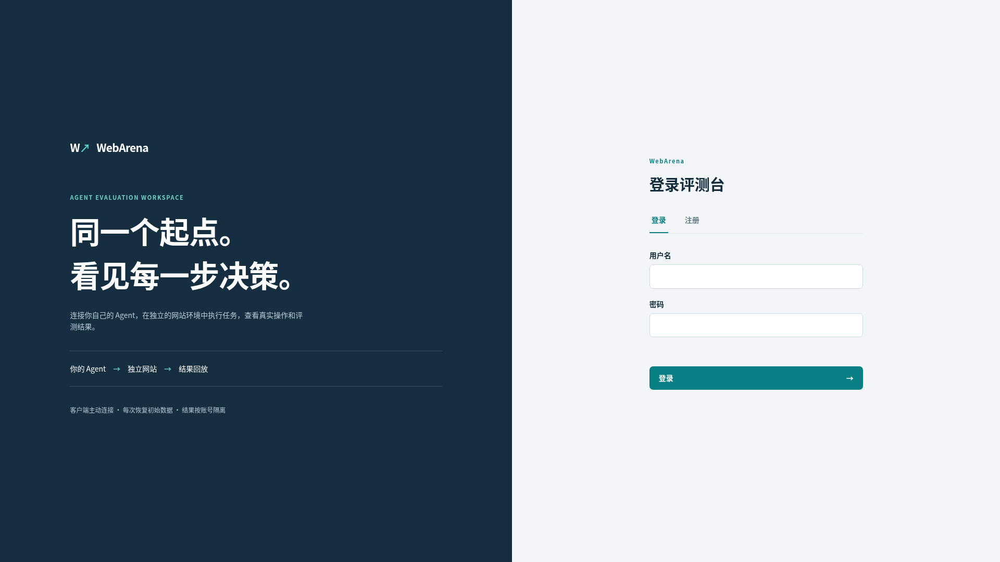

# WebAgent 赛题验收说明

> 来源：《WebAgent赛题验收说明.pptx》，共 10 页。编制：赛题验收组。转换日期：2026-10-29。按原页顺序转录，保留正文、判定规则表与截图，省略重复页眉和装饰性页码。

原始文件：[WebAgent赛题验收说明.pptx](../原始资料/WebAgent赛题验收说明.pptx)

## 第 1 页：赛题验收说明

华为软件难题挑战赛 · 智能体系统

赛题验收说明

《Web Agent 的并行执行与容错调度》

面向对象：全体参赛队伍

内容：验收构成 · 环境使用 · 判定规则 · 账号与纪律

编制：赛题验收组

10 + 1

验收用例构成（自动化 + 真实网站）

## 第 2 页：验收构成：10 个自动化用例 + 1 个真实网站用例，分两阶段进行

### 用例构成

### 10 个自动化用例

在我们部署的模拟环境（论坛、电商两个网站）上执行，任务声明完成后由程序化校验器自动核对结果。

### 1 个真实网站用例

在公开真实网站上进行，目标网站与任务于验收阶段公布，视频连线现场演示，由我们查验交互能力与并行化能力（浏览器中支持用户接管和多Tab页并行处理任务）。

### 阶段安排

### 第一阶段 · 比赛阶段

- 所有赛队共用一台调测服务器，内置少量调测用例
- Agent 在各队本地机器上开发，连接评测台联调
- 自行在真实网站验证 Web Agent 的交互能力与并行化能力

### 第二阶段 · 验收阶段

- 比赛时间结束后，我们公布最终自动化验收服务器地址
- 逐队视频连线，配合我们执行10+1用例验收
- 现场核对结果，按账号查验成绩

## 第 3 页：环境构成：Agent 在本地开发，连接模拟环境与真实网站执行任务

### 各队本地机器

- Web Agent（开发语言与框架不限）
- 模型：验收统一为 Qwen3.6-35B-A3B
- 自然语言任务指令在此输入
- 运行日志在此生成

客户端主动连接（评测台）

直接操作目标站点

### 评测服务器 · 模拟环境

- 论坛、电商两个网站，站点数据具备真实规模
- 每次任务恢复初始数据，结果按账号隔离
- 10 个自动化用例在此执行与校验

### 公开真实网站（用例于验收阶段公布）

- 1 个真实网站用例的演示与查验对象

说明：各队无需在本地部署模拟环境，也无需准备服务器；只需在本地完成 Agent 开发，通过网络连接评测服务器即可。调测地址见第 4 页。

## 第 4 页：比赛阶段三件事：注册账号、调测联调、真实网站自测

### 01. 注册评测台账号（每队一个，妥善保管）

请各队在调测服务器上自行注册账号。评测结果与账号绑定，验收时请提供给我们查验成绩。

调测地址：https://webarena.94-74-111-115.sslip.io/

### 02. 用调测用例联调（论坛 + 电商）

调测服务器内置论坛、电商两个网站和少量调测用例。Agent 在本地机器运行，主动连接评测台执行任务，通过结果回放查看每一步真实操作与评测结果，反复打磨并行执行与容错调度策略。

### 03. 在真实网站自测

请自行在公开真实网站上验证 Web Agent 的交互能力与并行化能力，为真实网站用例的视频演示做好准备（用例的目标网站由我们在验收阶段公布）。

注意：调测环境仅用于联调，调测成绩不作为最终成绩；最终成绩以验收阶段在最终验收服务器上的结果为准。

## 第 5 页：评测台机制：同一起点、账号隔离、全程可回放

### ① 客户端主动连接

Agent 运行在各队本地机器，由本地主动向评测台发起连接，无需开放任何入站端口。

### ② 每次恢复初始数据

每次任务执行前，网站数据恢复至同一份初始状态，保证所有队伍起点一致、任务可重复执行。

### ③ 结果按账号隔离

各队伍的评测结果与账号绑定、相互隔离，其他队伍无法查看。

### ④ 结果可回放

任务执行的真实操作过程与评测结果可在评测台回放，便于定位问题、复核结论。

图：评测台登录页（调测环境）。首次使用在登录页切换至「注册」创建本队账号。

## 第 6 页：验收阶段：以最终验收服务器为准，视频连线逐队验收

### 1. 公布地址

比赛时间结束后，我们公布最终验收服务器地址，验收以该地址为准。

### 2. 连接环境

用本队账号登录最终验收服务器，确认 Agent 可正常连接并执行任务。

### 3. 视频验收

按评委指令逐个执行验收用例，共享屏幕展示 Agent 运行过程与日志。

### 4. 查验成绩

当场核对各用例结果，我们按账号查验评测记录并确认成绩。

### 视频验收配合要点

- 请提前测试网络与设备，保证视频连线与屏幕共享稳定、画面可看清 Agent 操作过程；
- 验收阶段统一使用 Qwen3.6-35B-A3B 模型（35B MoE、激活 3B），请提前完成适配联调，届时会提供API Key；
- 演示真实网站用例时，请展示真实交互过程与多页面并行执行效果；
- 请全程使用本队账号，Agent 操作、日志输出与评测记录须一一对应。

## 第 7 页：自动化用例怎么判：二值判定、全程可审计

门槛：验收通过率不低于 60% 方可进入排名

| 规则 | 说明 |
| --- | --- |
| 结果核对 | 每个用例配有程序化校验器，按任务类型分别核查最终页面内容、目标地址或网站后台数据；任务声明完成后执行校验，确认结果符合要求。 |
| 二值判定 | 单个用例的验收结果只有「通过」与「不通过」，不设部分分。 |
| 计时口径 | 从任务指令下发起，至验收检查执行时止；登录、二次验证等人工干预时段不计入任务时长。 |
| 日志审计 | 应用须输出完整运行日志（操作时间、目标页面、动作类型、结果、模型调用量）。日志与实际页面操作不符、绕过网页直接篡改数据、预写死任务答案、调用外部模型等行为，一经发现取消成绩。 |

## 第 8 页：真实网站用例：现场演示交互能力与并行化能力

### 用例定位

本用例是验收中唯一在公开真实网站上进行的用例，目标是检验 Web Agent 走出模拟环境后的真实可用性。

目标网站与任务由我们在验收阶段公布；届时请通过视频连线现场演示，我们实时查验。

提示：真实网站环境不可控（改版、限流、验证码均可能出现），建议比赛阶段在多个公开站点上充分验证交互与并行策略，并保证人工介入环节衔接顺畅。

### 我们查验的四个关注点

### ① 真实交互

在真实页面上完成导航、检索等操作，而非预写死流程。

### ② 并行化能力

多个页面、多个子任务并行推进，能看到相对串行执行的耗时收益。

### ③ 限流合规

在目标网站的频率限制内运行，节奏受控，不触发冷却或封禁。

### ④ 人工介入衔接

登录、二次验证等环节能主动识别、暂停并提示用户操作，完成后自动恢复执行。

## 第 9 页：资源与账号规则：每队同一时间只跑一个评测任务，账号即成绩凭据

### 01. 单任务串行

因服务器资源有限，每个赛队同一时间只能运行一个评测任务。请排队依次执行，不要并发提交多个任务抢占资源，否则可能影响本队及其他队伍的评测结果。

### 02. 自行注册登录

在评测台自行注册账号并登录后使用。一队一个账号，不要与其他队伍共用。

### 03. 牢记账号，验收时提供查验

评测结果与账号绑定。验收时请把本队账号提供给我们查验成绩；账号遗失或无法提供的，相关评测记录不予认定。

成绩以账号下的评测记录为准。账号混用、借用或冒用他人评测记录，一经发现取消成绩。

## 第 10 页：验收前最后一步：对照清单自查，不碰红线

### 自查清单（逐项确认）

- [ ] 能登录最终验收服务器并正常连接 Agent

- [ ] 10 个自动化用例在模拟环境全部跑通

- [ ] 真实网站用例的目标站点与演示流程就绪

- [ ] 运行日志输出完整、字段齐全

- [ ] 本队账号信息已记录，可现场提供给我们

- [ ] Agent 已适配验收统一模型 Qwen3.6-35B-A3B

### 红线（违反即记 0 分或取消成绩）

- 验收阶段统一使用 Qwen3.6-35B-A3B（35B MoE、激活 3B）模型，如有更轻量的模型辅助需报备；
- 禁止调用其它高规格云端模型、外部 API 或外部算力；
- 绕过网页直接篡改数据、预写死任务答案、日志造假的，取消成绩。

预祝各位取得好成绩。—— 赛题验收组
