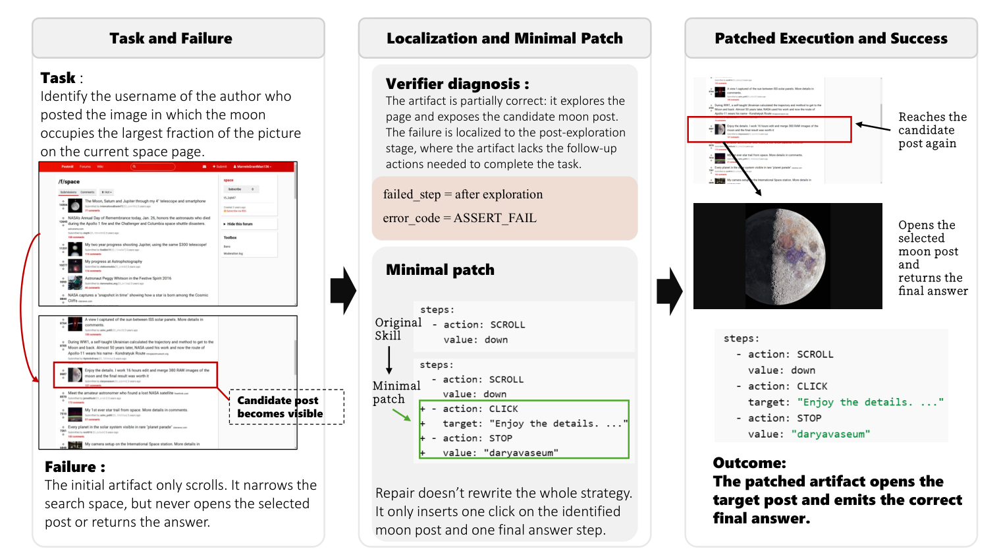
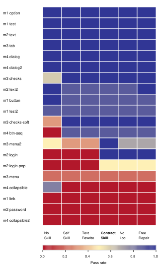
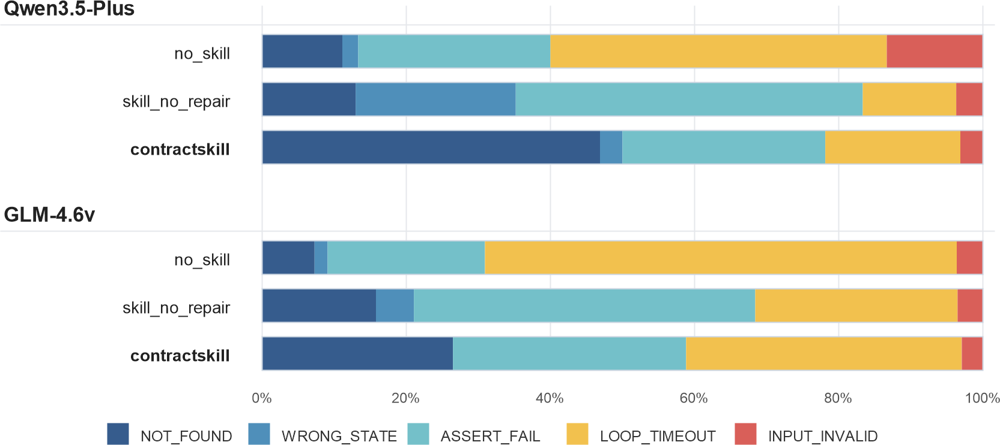
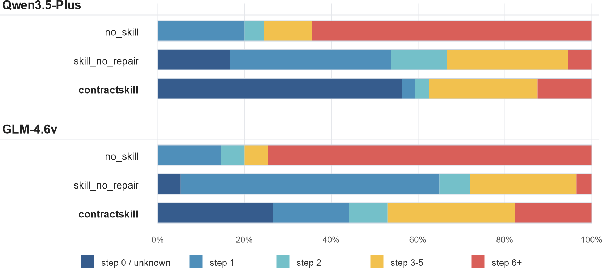

# ContractSkill: Repairable Contract-Based Skills for Multimodal Web Agents

CCS: Computing methodologies Intelligent agentsCCS: Human-centered computing Empirical studies in HCICCS: Information systems World Wide Web

- **Zijian Lu** · Nanjing University of Posts and Telecommunications , Nanjing , China · 18818732360@163.com
- **Yiping Zuo** · Nanjing University of Posts and Telecommunications , Nanjing , China · zuoyiping@njupt.edu.cn
- **Yupeng Nie** · Nanjing University of Posts and Telecommunications , Nanjing , China · 18094228550@163.com
- **Xin He** · Nanjing University of Posts and Telecommunications , Nanjing , China · xhe@njupt.edu.cn
- **Weibei Fan** · Nanjing University of Posts and Telecommunications , Nanjing , China · wbfan@njupt.edu.cn
- **Lianyong Qi** · China University of Petroleum (East China) , Qingdao , China · lianyongqi@gmail.com
- **Shi Jin** · Southeast University , Nanjing , China · jinshi@seu.edu.cn

###### Abstract.

Self-generated skills for web agents are often unstable and can even hurt performance relative to direct acting. We argue that the key bottleneck is not only skill generation quality, but the fact that web skills remain implicit and therefore cannot be checked or locally repaired. To address this, we present ContractSkill, a framework that converts a draft skill into an executable artifact with explicit procedural structure, enabling deterministic verification, fault localization, and minimal local repair. This turns skill refinement from full rewriting into localized editing of a single skill artifact. Experiments on VisualWebArena show that ContractSkill is effective in realistic web environments, while MiniWoB provides a controlled test of the mechanism behind the gain. Under matched transfer layers, repaired artifacts also remain reusable after removing the source model from the loop, providing evidence of portability within the same benchmark family rather than full-benchmark generalization. These results suggest that the central challenge is not merely generating skills, but making them explicit, executable, and repairable. Code is available at <https://github.com/underfitting-lu/contractskill.git>.

###### Keywords:

Skill, Multimodal Web Agents, Contracted Executable Artifacts, Self-Generated, Cross-Model Transfer

## 1. Introduction

Long-horizon web tasks seem like exactly the setting where skills should help most. Yet recent evidence already points to a striking mismatch between that intuition and current practice. SkillsBench ([Li et al., 2026](#bib.bib15)) reports that curated skills raise average pass rate by 16.2 percentage points, whereas self-generated skills provide no benefit on average . For us, this is the real motivating anomaly. It suggests that the problem is not whether external procedural knowledge can help agents, but whether model-written skills are stable enough to serve as executable objects in the first place.

Our diagnosis is object-centered rather than pipeline-centered. The key bottleneck is not only skill generation quality, but the fact that web skills remain implicit and therefore cannot be checked or locally repaired. Most draft skills are loose textual objects: they omit explicit preconditions, blur step boundaries, leave success evidence underspecified, and provide no principled recovery policy when the page state diverges. Once execution fails, the agent typically rewrites the whole skill or abandons it altogether.

This diagnosis also clarifies the gap with prior work. Reflection and self-repair methods update trajectories, memories, or transient plans in the current episode ([Shinn et al., 2023](#bib.bib23); [Wang et al., 2024b](#bib.bib27)). Skill-bank style work maintains larger workflow collections or reusable knowledge repositories in open-ended settings ([Wang et al., 2024a](#bib.bib26); [Chen et al., 2025](#bib.bib5)). Our target is different. We update the single skill artifact itself. The question we ask is whether a model-written web skill can be turned into an explicit object with preconditions, steps, postconditions, recovery rules, and termination checks, so that it becomes executable, diagnosable, locally repairable, and consumable by another model.

We therefore propose ContractSkill, which converts a draft skill into an executable contract and improves it through deterministic verification, fault localization, and minimal patch repair. Starting from a model-generated draft, ContractSkill compiles the skill into an explicit artifact, executes it under a deterministic verifier, localizes failure to a specific step and error type, and edits only the implicated selector, condition, recovery rule, or action argument. Instead of treating failure as a reason to regenerate the whole skill, the framework treats it as a local repair problem over a persistent procedural object. The repaired artifact can then be reused by the source model or consumed by a target model without regenerating the skill.

We test this claim from three complementary angles. First, on VisualWebArena, ContractSkill improves execution in realistic multimodal web interaction where naive self-generated skills fail. Second, in MiniWoB, controlled comparisons show that the gain comes from deterministic verification, fault localization, and minimal repair rather than rewriting alone. Third, under matched transfer layers, repaired artifacts remain reusable across GLM-4.6V and Qwen3.5-Plus after removing the source model from the loop. This is a benchmark-specific test of portability rather than a claim of full-benchmark generalization.

We summarize the primary contributions of this paper below.

- •

  We identify the failure of self-generated web skills as a representation problem rather than only a generation problem, motivated by prior evidence that self-generated skills often fail to deliver the gains achieved by curated procedural knowledge.
- •

  We propose ContractSkill, an object-centered repair framework that converts a draft skill into an executable contract and improves the single skill artifact itself through deterministic verification, fault localization, and minimal patch operators.
- •

  We show that ContractSkill is effective on VisualWebArena, while MiniWoB validates the mechanism under controlled conditions. We further show that matched transfer layers provide evidence that repaired artifacts remain reusable across models after removing the source model from the loop. This is a benchmark-specific portability claim rather than one of full-benchmark generalization.

Figure [1](#acmlabel1) summarizes this artifact-centric workflow from draft generation to verifier-guided repair and downstream reuse.

Figure 1. Overview of ContractSkill. The pipeline proceeds through five stages. It starts with input and draft generation, then compiles the draft into a contracted artifact, performs verification-guided execution with deterministic fault localization, applies minimal patch repair under an explicit objective, and finally reuses the repaired artifact with both the source model and a target model.A five-stage pipeline for ContractSkill showing input and draft generation, skill compilation into a contracted artifact, verification-guided execution with deterministic fault localization, minimal patch repair, and downstream reuse by source and target models.

## 2. Related Work

We organize prior work around the reliability of self-generated web skills, focusing on why stronger skill generation alone does not guarantee executable and reusable skill artifacts, how prior work improves behavior online or externalizes procedure to narrow this gap, and what verifier-guided evidence is needed to make such artifacts auditable and repairable under a fixed execution protocol.

### 2.1. Multimodal Web Agents

Recent benchmarks have rapidly expanded the scope of multimodal web agents. World of Bits and MiniWoB established controlled browser settings for basic interaction, while WebArena and VisualWebArena pushed evaluation toward longer-horizon, more realistic, and visually grounded web workflows ([Shi et al., 2017](#bib.bib22); [Liu et al., 2018](#bib.bib16); [Zhou et al., 2024](#bib.bib42); [Koh et al., 2024](#bib.bib12)). Other resources, including Mind2Web, WebLINX, BrowserGym, WorkArena++, SeeAct, AutoWebGLM, AgentOccam, and scaling-oriented agent training efforts, further broaden the empirical landscape ([Deng et al., 2023](#bib.bib8); [Lu et al., 2024](#bib.bib18); [de Chezelles et al., 2025](#bib.bib7); [Boisvert et al., 2024](#bib.bib3); [Zheng et al., 2024](#bib.bib41); [Lai et al., 2024](#bib.bib13); [Yang et al., 2025](#bib.bib34); [Trabucco et al., 2025](#bib.bib25)). These benchmarks are crucial for exposing realistic failure modes, but they mostly evaluate end-to-end agent behavior rather than how a self-generated web skill should be represented, verified, and repaired after execution breaks.

### 2.2. Self-Repair and Reflection in Agents

Within these environments, self-repair and reflection methods improve agent behavior by revising trajectories, reasoning traces, memories, or policies after observing failure ([Shinn et al., 2023](#bib.bib23); [Wang et al., 2024b](#bib.bib27); [Yao et al., 2026](#bib.bib36); [Weng et al., 2026](#bib.bib30); [Yao et al., 2023](#bib.bib35); [Zhao et al., 2024](#bib.bib39)). These literatures are highly relevant for web agents because they shows that feedback-driven refinement can materially improve performance in interactive environments. However, the object being updated is usually the agent’s ongoing behavior or internal state in the current episode. By contrast, we repair an externalized skill artifact itself so that the result persists as a reusable object across episodes and can also be consumed by another model.

### 2.3. Skill Artifacts and Procedural Knowledge

A complementary line of work treats skills as explicit, reusable procedural knowledge rather than transient prompting context ([Xu and Yan, 2026](#bib.bib33); [Li et al., 2026](#bib.bib15); [Li, 2026](#bib.bib14)). Agent Workflow Memory stores reusable textual workflows, ASI induces and verifies executable programmatic skills online, PolySkill separates abstract goals from concrete implementations for cross-site reuse, SkillWeaver discovers website-specific APIs, Hierarchical Memory Tree organizes web experience with explicit pre/post conditions, and RAG-GUI retrieves external GUI guidance at inference time ([Wang et al., 2025b](#bib.bib29); [Wang et al., 2025a](#bib.bib28); [Yu et al., 2025](#bib.bib37); [Zheng et al., 2025](#bib.bib40); [Tan et al., 2026](#bib.bib24); [Xu et al., 2025](#bib.bib32)). This line is the closest to ours, but most prior work studies reusable knowledge at the level of workflow collections, APIs, or broader memory structures. Our focus is narrower and more operational: a single model-written multimodal web skill that must become executable, diagnosable, minimally repairable, and reusable across models.

### 2.4. Program Repair and Verifier-Guided Optimization

Once the skill itself becomes the repair target, program repair provides the methodological lens for our framework. Classic work such as GenProg, PAR, SemFix, DirectFix, Angelix, and Prophet emphasizes three ideas that are equally central here: localize the failure, constrain the edit space, and use a verifier to decide whether a patch should be accepted ([Goues et al., 2012](#bib.bib10); [Kim et al., 2013](#bib.bib11); [Nguyen et al., 2013](#bib.bib21); [Mechtaev et al., 2015](#bib.bib19); [Mechtaev et al., 2016](#bib.bib20); [Long and Rinard, 2016](#bib.bib17)). Verifier-guided refinement frameworks such as counterexample-guided abstraction refinement further show how failed checks can drive iterative improvement ([Clarke et al., 2000](#bib.bib6)). We borrow these principles not to repair source code directly, but to repair executable web-skill artifacts whose correctness is grounded in observable page-state evidence.

## 3. Problem Definition

### 3.1. Environment

We study a multimodal web environment similar to VisualWebArena, WorkArena, and OSWorld ([Koh et al., 2024](#bib.bib12); [Drouin et al., 2024](#bib.bib9); [Xie et al., 2024](#bib.bib31)). An agent receives a natural-language task instruction $x$ . At step $t$ , the environment provides an observation $o_{t}=(I_{t},D_{t})$ , where $I_{t}$ is the current page screenshot and $D_{t}$ is a structured page summary, such as a Document Object Model (DOM) abstraction, accessibility summary, or textual page state description. The agent outputs an action $a_{t}\in\mathcal{A}$ , where $\mathcal{A}$ includes operations such as click, type, scroll, and select. The environment then transitions to a new observation $o_{t+1}$ .

Task success is judged by a deterministic verifier $V$ . Unlike free-form language judgments, $V$ checks final and intermediate page states using reproducible signals, such as URL patterns, DOM matches, text presence, form values, or page-state transitions. This design is consistent with evaluation practice in reproducible web-agent benchmarks, which ground success in observable page evidence rather than subjective model preferences ([Zhou et al., 2024](#bib.bib42); [Koh et al., 2024](#bib.bib12); [Drouin et al., 2024](#bib.bib9)). This setting lets us reason about failure in programmatic terms rather than relying only on subjective model reflection.

### 3.2. Draft Skill

Given instruction $x$ and an initial observation, a source model first generates a textual draft skill $s_{0}$ . This draft is a weak procedural object because it contains useful action intent but is not yet executable in a controlled or verifiable way. In particular, $s_{0}$ may omit hidden state assumptions, under-specify selectors, conflate goals with actions, or fail to state what evidence marks step completion. This pattern is common in self-generated manuals, mobile skills, and benchmarked skill artifacts ([Zhang et al., 2025](#bib.bib38); [Chen et al., 2024](#bib.bib4); [Li et al., 2026](#bib.bib15)). We therefore treat the draft as a starting point rather than as the final reusable skill.

### 3.3. Contracted Skill Artifact

The core object in this paper is the contracted skill artifact $s$ . We formalize it as

| (1) |  | 

$$
s=\bigl(g,P,U,Q,R,T\bigr),\qquad U=\{u_{j}\}_{j=1}^{m},
$$

 |
| --- | --- | --- |

where $g$ is the goal, $P$ denotes preconditions, $U$ is the ordered step list, $Q$ denotes postconditions, $R$ denotes recovery rules, and $T$ denotes termination checks. Each step is itself a structured object,

| (2) |  | 

$$
u_{j}=\bigl(\mathrm{sel}_{j},\mathrm{act}_{j},\mathrm{arg}_{j},\Pi_{j}\bigr),
$$

 |
| --- | --- | --- |

where $\mathrm{sel}_{j}$ is the selector, $\mathrm{act}_{j}$ is the action type, $\mathrm{arg}_{j}$ denotes optional arguments, and $\Pi_{j}$ is the set of post-assertions for step $j$ . This representation makes the skill executable at the step level and gives the verifier explicit hooks for diagnosis. It also makes the skill closer in spirit to reusable external knowledge objects, such as interaction manuals and structured prior knowledge stores, than to a one-off prompt fragment ([Chen et al., 2024](#bib.bib4); [Wang et al., 2024a](#bib.bib26); [Chen et al., 2025](#bib.bib5)).

### 3.4. Objective

Starting from draft skill $s_{0}$ , we search over a local neighborhood of candidate repairs and seek an improved artifact $s^{\ast}$ that balances success, cost, and edit size according to the following objective.

| (3) |  | 

$$
s^{\ast}=\arg\max_{s\in\mathcal{N}_{K}(s_{0})}\mathrm{Succ}(s)-\lambda\mathrm{Cost}(s)-\gamma\mathrm{Edit}(s,s_{0}).
$$

 |
| --- | --- | --- |

Here $\mathrm{Succ}(s)$ denotes task success under the verifier, $\mathrm{Cost}(s)$ captures execution cost such as action count or tool calls, and $\mathrm{Edit}(s,s_{0})$ penalizes unnecessarily large modifications. This objective reflects the desired behavior of a repair system, which is to improve the skill while preserving as much of the original procedural content as possible. The edit penalty is deliberately aligned with minimal-change preferences that have been useful in program repair.

## 4. ContractSkill

### 4.1. Skill Artifact Schema

ContractSkill represents each skill as an explicit artifact with the fields skill\_name, goal, preconditions, steps, postconditions, recovery, and terminate. Each step contains four mandatory elements: selector, action, args, and post\_assertion. Compared with free-form text, this schema exposes the exact operational assumptions behind the skill. The schema is designed to externalize procedures as reusable objects, which is also the motivating direction behind manual construction and page-level knowledge extraction in recent agent systems.

### 4.2. Deterministic Verifier

We distinguish two verification levels. A final verifier determines whether the full task has succeeded, and a step verifier checks whether each action was executed under valid state assumptions and produced the expected page evidence. Let $\mathcal{T}$ denote the execution trace together with the page-state trace. We write the verifier as

| (4) |  | 

$$
\mathcal{V}(s,\mathcal{T})=\begin{cases}1,&\text{if the task succeeds,}\\
(0,i,e,\tau_{i}),&\text{otherwise,}\end{cases}
$$

 |
| --- | --- | --- |

where $i$ is the failed step index, $e$ is a structured error code, and $\tau_{i}$ is the local trace evidence used for diagnosis. Verification uses deterministic checks such as URL matching, DOM retrieval, textual assertions, form-value checks, and state-change predicates. In practice, selectors are resolved on the current accessibility or DOM snapshot using role, visible text, and stable attributes rather than persistent node ids. Postconditions are instantiated from action-specific templates, such as value matching for type, state or navigation change for click, and option validation for select. This design keeps the repair signal grounded in observable page state rather than in model self-evaluation, matching the execution-oriented evaluation logic used in WebArena, VisualWebArena, and WorkArena ([Zhou et al., 2024](#bib.bib42); [Koh et al., 2024](#bib.bib12); [Drouin et al., 2024](#bib.bib9)). Table [1](#S4.T1) summarizes the structured error codes returned by the verifier.

Table 1. Structured error codes used by the deterministic verifier.

| Error code | Meaning |
| --- | --- |
| NOT_FOUND | The specified selector does not match a valid page element. |
| WRONG_STATE | The current page state violates a step precondition. |
| ASSERT_FAIL | The action completes, but the expected postcondition is not satisfied. |
| LOOP_TIMEOUT | The agent repeats unproductive actions or exceeds the step budget. |
| INPUT_INVALID | The action arguments do not satisfy page-side constraints. |

### 4.3. Fault Localization

When execution fails, ContractSkill does not treat the failure as a monolithic property of the entire skill. Instead, it extracts a localized diagnosis

| (5) |  | 

$$
(i,e,\tau_{i})=\mathrm{Localize}\bigl(s,\mathcal{T}\bigr),
$$

 |
| --- | --- | --- |

where $i$ is the failed step index, $e$ is the structured error code, and $\tau_{i}$ is the relevant trace snippet or page-state evidence. This step-level localization is important because different failures imply different repair actions. A missing selector and an invalid state assumption should not trigger the same patch strategy. The same diagnosis-first discipline is central in semantics-based repair methods, which isolate a small repair site before synthesis or validation ([Nguyen et al., 2013](#bib.bib21); [Mechtaev et al., 2016](#bib.bib20)).

### 4.4. Minimal Patch Operators

We define five local patch operators,

| (6) |  | 

$$
\mathcal{P}=\begin{aligned} \{&\textsc{SelReplace},\textsc{PreInsert},\textsc{PostInsert},\\
&\textsc{RecoveryInsert},\textsc{ArgCorrect}\}.\end{aligned}
$$

 |
| --- | --- | --- |

Using this operator set, the $K$ -step repair neighborhood of the draft artifact is

| (7) |  | 

$$
\mathcal{N}_{K}(s_{0})=\left\{p_{k}\circ\cdots\circ p_{1}(s_{0})\;\middle|\;p_{r}\in\mathcal{P},\;0\leq k\leq K\right\}.
$$

 |
| --- | --- | --- |

Each operator changes only the artifact fragment tied to the diagnosed failure. This design preserves the rest of the artifact and avoids the instability that often accompanies full-text rewrites. The operator set intentionally favors small, interpretable edits, echoing the minimality bias emphasized in DirectFix and learning-guided repair systems such as Prophet ([Mechtaev et al., 2015](#bib.bib19); [Long and Rinard, 2016](#bib.bib17)). Table [2](#S4.T2) summarizes these minimal patch operators.

Table 2. Minimal patch operators in ContractSkill.

| Operator | Typical use |
| --- | --- |
| Selector replacement | Replace or expand a brittle selector after NOT_FOUND . |
| Precondition insertion | Add a missing state assumption after WRONG_STATE . |
| Postcondition insertion | Add missing evidence of completion after ASSERT_FAIL . |
| Recovery insertion | Add a fallback action such as close-popup or reload. |
| Argument correction | Fix input values or action arguments after INPUT_INVALID . |

### 4.5. Verifier-Guided Repair Loop

Algorithmically, ContractSkill follows an iterative execute-diagnose-patch-validate loop. First, the source model produces a draft skill and compiles it into an artifact. Second, the artifact is executed on a repair set. Third, the verifier reports the failing step and error code. Fourth, the repair module chooses one or more minimal patch operators and constructs candidate patches. Finally, each candidate is validated under the same verifier and accepted only if it improves the current score. Concretely, we write

| (8) |  | 

$$
J(s)=\mathrm{Succ}(s)-\lambda\mathrm{Cost}(s)-\gamma\mathrm{Edit}(s,s_{0}),
$$

 |
| --- | --- | --- |
| (9) |  | 

$$
\mathrm{Accept}(s^{\prime},s)=\begin{cases}1,&\text{if }J(s^{\prime})>J(s),\\
0,&\text{otherwise.}\end{cases}
$$

 |
| --- | --- | --- |

In our setup, each round is limited to a small edit budget, typically one to three patches, so that repair remains local and interpretable. The acceptance logic follows the broader verifier-guided refinement pattern in which counterexamples or failed checks narrow the next search step ([Clarke et al., 2000](#bib.bib6)).

Figure 2. Representative repair case on VisualWebArena. The verifier localizes the failure to the post-exploration stage, and ContractSkill repairs the artifact by inserting only the missing continuation steps rather than rewriting the whole strategy.A qualitative case study showing task failure, verifier localization, minimal patch insertion, and successful patched execution on a VisualWebArena task.

## 5. Experimental Setup

Our experiments are organized around three questions. We ask (1) whether ContractSkill improves end-to-end web execution over direct acting and naive skill use, (2) whether any improvement comes specifically from verifier-guided local repair rather than rewriting alone, and (3) whether repaired skill artifacts remain reusable by another model under matched transfer layers after the source model is removed from the loop. Across all experiments, we treat efficiency as a success-cost trade-off rather than strict dominance over every baseline: the point is to test whether modest extra execution cost can buy substantially higher success when brittle self-generated skills fail. We structure the evaluation accordingly.

### 5.1. Benchmarks and Evaluation Splits

We evaluate on two benchmarks with complementary roles. VisualWebArena (VWA) ([Koh et al., 2024](#bib.bib12)) serves as the realistic multimodal web benchmark, where long-horizon interaction and environment noise make brittle skills particularly costly. We report VWA results on the cleaned main\_100 subset, i.e., the 100 tasks for which matched summaries are available across all compared runs. For MiniWoB ([Liu et al., 2018](#bib.bib16)), we use the main\_20 handbook split, which contains 20 tasks with 10 instances per task. We evaluate both benchmarks over three runs. MiniWoB serves as a controlled benchmark with simpler task structure, allowing the effect of repair decisions to be isolated more cleanly. This yields 300 task-level evaluations on VWA and 600 evaluation episodes on MiniWoB in total.

For transfer, we replace the usual seen-versus-held-out template split with benchmark-specific transfer layers that better match our claim. Layer 1 (layer1\_paired\_success) contains tasks that both source models originally solve, enabling paired comparisons under matched difficulty. Layer 2 (layer2\_source\_only\_success) contains tasks solved by only one source model, which directly tests whether a repaired skill can carry useful procedural knowledge beyond the overlap of easy cases. We report both directional settings, Q $\rightarrow$ G and G $\rightarrow$ Q.

### 5.2. Models

We instantiate the source and target agents with GLM-4.6V and Qwen3.5-Plus. In the self-use setting, the same model generates the draft skill, repairs it, and executes the repaired artifact. In the transfer setting, the source model produces and repairs the artifact, while the target model consumes it without regenerating the skill. This separation lets us test whether the final artifact encodes reusable procedure rather than model-specific hidden context.

### 5.3. Baselines

We compare against two core baselines in all main-result tables. No-Skill executes the task directly without any external procedural guidance, representing the standard direct-acting setting. Self-Generated Skill lets the acting model produce a skill and immediately use it, but does not perform verifier-guided repair after failure. It therefore isolates the effect of skill writing alone, without the additional benefit of explicit verification or repair. On MiniWoB, we additionally include more controlled comparisons. Text-Only Rewrite rewrites the skill after failure in free-form text, without contracts, structured error codes, or localized edits, and therefore isolates the effect of rewriting alone. We also report two ablations of ContractSkill. No Failure Localization removes targeted identification of the failing skill component, and Unconstrained Repair permits broad revisions rather than restricted local fixes. These controlled variants help determine whether the gains of ContractSkill arise from structured verifier-guided repair.

### 5.4. Metrics

Our primary metric is verifier-based success rate. Under this framing, we also report average steps and average total tokens whenever those fields are present in the cleaned summaries. A repaired artifact may spend extra steps or tokens to complete tasks that a brittle self-generated skill fails to finish. Tokens are reported as average total tokens per task and abbreviated in thousands (k). For transfer, we compare repaired-artifact execution against the target model’s own self-generated skill baseline and report both absolute success and the point improvement.

### 5.5. Implementation Details

All compared methods use the same observation interface, action space, and deterministic verifier. For fairness, we keep the execution budget and the maximum allowed repair effort fixed across methods within each benchmark family. The verifier evaluates structured environment state through deterministic checks, including URL consistency, visible-text matching, form-value validation, and retrieval over the DOM summary. We re-resolve selectors on the latest page snapshot after every action and allow a short wait-and-requery window for delayed rendering, which reduces brittleness to dynamic interfaces without introducing non-deterministic matching. This controlled setup makes the comparison method-centric. Gains cannot be attributed to extra interaction budget, different action primitives, or weaker success criteria.

## 6. Main Results

We report the main results in the order of argumentative strength. We first test whether ContractSkill works in realistic web interaction, then examine the same claim in a controlled environment where the mechanism is easier to isolate, and finally test whether the repaired artifact remains reusable under matched transfer layers after the source model is removed from the loop.

### 6.1. VisualWebArena

Table [3](#S6.T3) reports the main VWA results. The overall pattern is clear. On realistic web tasks, simply having a skill is not enough, but repairing it into a contracted artifact is consistently beneficial. With GLM-4.6V, ContractSkill reaches 28.1% success, compared with 12.5% for No-Skill and 9.4% for Self-Generated Skill. The efficiency profile also improves. Average steps drop from 12.59 for No-Skill to 3.62, and average token usage decreases from 52.7k to 46.45k. With Qwen3.5-Plus, the packaged final verified aggregation raises ContractSkill to 37.5%, exceeding both No-Skill (28.1%) and Self-Generated Skill (10.9%), while keeping average token usage slightly below No-Skill (40.1k vs. 42.6k). On VWA, self-generated skills can underperform direct acting because an unverified but committed procedure often fails early and suppresses corrective exploration. As a result, brittle skills may use fewer steps and tokens precisely because they commit to the wrong procedure too soon. These results matter because VWA is precisely the regime in which brittle skills tend to fail, with long trajectories, changing page state, and multimodal ambiguity. The fact that ContractSkill improves both models suggests that the gain comes from structured repair of the external artifact rather than from model-specific prompting tricks.

Table 3. Main results on VisualWebArena main\_100.

| GLM-VWA |  |  |  |
| --- | --- | --- | --- |
| Method | Succ. (%) | Steps | Tokens (k) |
| No-Skill | 12.5 | 12.59 | 52.7 |
| Self-Generated Skill | 9.4 | 1.95 | 5.6 |
| ContractSkill | 28.1 | 3.62 | 46.45 |
| Qwen-VWA |  |  |  |
| Method | Succ. (%) | Steps | Tokens (k) |
| No-Skill | 28.1 | 9.41 | 42.6 |
| Self-Generated Skill | 10.9 | 1.91 | 7.3 |
| ContractSkill | 37.5 | 8.52 | 40.1 |

Note. Tokens are average total tokens per task reported in thousands.

### 6.2. MiniWoB

Table [4](#S6.T4) provides the controlled counterpart to the VWA findings. Here the conclusion is even cleaner. ContractSkill is the strongest method for both models, reaching 77.5% on GLM and 81.0% on Qwen. Relative to Self-Generated Skill, the improvement is 11.0 points for GLM and 20.5 points for Qwen. The efficiency numbers show that this gain is not achieved by reverting to expensive direct exploration. On GLM, ContractSkill uses 1.93 average steps and 5.16k tokens, remaining far below the 4.11-step cost of No-Skill. On Qwen, ContractSkill increases steps only slightly over Self-Generated Skill (2.00 vs. 1.85) while producing a much larger success gain. Because MiniWoB removes much of the uncontrolled noise present in open web environments, these results strengthen the central claim that the improvement comes from repairable external procedure, not merely from extra interaction budget. We place Text-Only Rewrite in the ablation table below, where it serves as the most direct check against the “it is just rewriting” alternative explanation.

Table 4. Main results on MiniWoB main\_20 with 10 instances per task.

| GLM-MiniWoB |  |  |  |
| --- | --- | --- | --- |
| Method | Succ. (%) | Steps | Tokens (k) |
| No-Skill | 61.5 | 4.11 | 4.44 |
| Self-Generated Skill | 66.5 | 1.84 | 4.6 |
| ContractSkill | 77.5 | 1.93 | 5.16 |
| Qwen-MiniWoB |  |  |  |
| Method | Succ. (%) | Steps | Tokens (k) |
| No-Skill | 56.5 | 1.61 | 1.9 |
| Self-Generated Skill | 60.5 | 1.85 | 4.5 |
| ContractSkill | 81.0 | 2.00 | 7.9 |

Note. Tokens are average total tokens per task reported in thousands.

### 6.3. Portability Under Matched Transfer Layers

Table [5](#S6.T5) tests a narrower claim than broad cross-benchmark transfer: whether the repaired artifact remains useful after the source model is removed from the loop under benchmark-specific matched transfer layers. The results provide positive evidence for that claim. Aggregated over both directions, transfer raises VWA success from 32.6% to 80.4% (+47.8 points) and MiniWoB success from 83.5% to 96.2% (+12.8 points) relative to the target model’s own self-generated skill baseline. The directional results show the same pattern rather than a one-sided effect. On VWA, Q $\rightarrow$ G improves from 29.2% to 79.2%, and G $\rightarrow$ Q improves from 36.4% to 81.8%. On MiniWoB, Q $\rightarrow$ G reaches 100.0% versus 87.5%, and G $\rightarrow$ Q reaches 92.3% versus 79.2%. Transfer execution remains lightweight, requiring only 1.77–3.21 average steps depending on the direction, and the released summaries record zero live token usage because the artifact is reused instead of regenerated online. The main takeaway is not unrestricted transfer, but artifact reuse after removing the source model from the loop. The Layer 2 gains are especially informative because they show reuse beyond the easy overlap region within this matched setting, even though the evaluation still stays within the same benchmark family.

Table 5. Portability under matched transfer layers compared against the target model’s own self-generated skill baseline. Aggregate rows merge Layer 1 and Layer 2 within each benchmark.

| Setting | Transfer Succ. (%) | Target Skill (%) | Delta | Transfer Steps | Baseline Steps |
| --- | --- | --- | --- | --- | --- |
| VWA (aggregate) | 80.4 | 32.6 | +47.8 | 2.83 | 1.46 |
| VWA Q $\rightarrow$ G | 79.2 | 29.2 | +50.0 | 3.21 | 1.46 |
| VWA G $\rightarrow$ Q | 81.8 | 36.4 | +45.5 | 2.41 | 1.45 |
| MiniWoB (aggregate) | 96.2 | 83.5 | +12.8 | 1.80 | 1.66 |
| MiniWoB Q $\rightarrow$ G | 100.0 | 87.5 | +12.5 | 1.84 | 1.68 |
| MiniWoB G $\rightarrow$ Q | 92.3 | 79.2 | +13.1 | 1.77 | 1.63 |

## 7. Analysis and Ablation

We next ask why the main gains appear. Since the MiniWoB bundles provide the most complete controlled ablations, we use them to isolate the contribution of structured repair.

### 7.1. Failure Localization and Minimal Repair

Table [6](#S7.T6) supports two conclusions. First, the gain is not explained by rewriting alone. Text-Only Rewrite reaches only 62.0% on GLM and 60.5% on Qwen, far below full ContractSkill at 77.5% and 81.0%, respectively. This gap is important because Text-Only Rewrite already gives the model an opportunity to revise the skill after observing failure; what it lacks is the contracted artifact, explicit verifier feedback, and localized repair target.

Figure [2](#acmlabel2) shows the same mechanism qualitatively on a representative VWA task. In this example, the original artifact already narrows the search space and surfaces the candidate moon post, but it stops at the exploration stage and never performs the final task-completing actions. The verifier localizes this failure as a missing continuation after exploration, and the repair module inserts only the missing click and answer steps. The repaired artifact therefore succeeds without changing the rest of the strategy.

Second, both design choices in ContractSkill matter. Removing failure localization drops performance to 65.0% on GLM and 70.0% on Qwen, indicating that knowing where the artifact fails is a major part of the benefit. Relaxing the repair objective into unconstrained editing performs slightly better than removing localization, but still reaches only 68.5% on GLM and 70.5% on Qwen. The efficiency trend points in the same direction. On Qwen, unconstrained repair increases average token usage from 7.9k to 11.3k without recovering the lost success. On GLM, it also increases token usage beyond both Text-Only Rewrite and the localization ablation. Taken together, these results support the intended mechanism of ContractSkill. Failure localization narrows the repair site, and minimal patching prevents costly global rewrites that are harder to validate and easier to destabilize.

Table 6. MiniWoB ablation results for fault localization and repair constraints.

|  | GLM-MiniWoB |  |  | Qwen-MiniWoB |  |  |
| --- | --- | --- | --- | --- | --- | --- |
| Variant | Success (%) | Avg. Steps | Avg. Tokens (k) | Success (%) | Avg. Steps | Avg. Tokens (k) |
| Full ContractSkill | 77.5 | 1.93 | 5.16 | 81.0 | 2.00 | 7.9 |
| Unconstrained Repair | 68.5 | 1.92 | 6.6 | 70.5 | 2.00 | 11.3 |
| No Failure Localization | 65.0 | 1.75 | 4.9 | 70.0 | 1.95 | 7.4 |
| Text-Only Rewrite | 62.0 | 1.71 | 2.7 | 60.5 | 1.70 | 5.3 |

Note. Tokens are average total tokens per task reported in thousands.

### 7.2. Template-Level MiniWoB Patterns

Figure [3](#acmlabel3) adds template-level pass rates to the aggregate MiniWoB ablation. Many easy templates are already saturated across all methods, so the overall gain does not come from uniform improvement everywhere. Instead, the advantage of full ContractSkill concentrates on a smaller set of templates that require reliable continuation after partial progress. The clearest gains appear on the two login templates and on mw\_m3\_click\_menu\_2, where the repaired artifact clearly outperforms both skill\_no\_repair and text\_only\_rewrite.

The same figure also clarifies the remaining boundary cases. Some templates remain unsolved for every method, including mw\_m1\_click\_link and mw\_m2\_enter\_password. A different failure mode appears on mw\_m4\_click\_collapsible, where no-skill execution outperforms all skill-based variants. This pattern is consistent with the mechanism suggested by Table [6](#S7.T6). Structured repair helps most when there is a reusable procedural skeleton to preserve and patch, but it is not a universal substitute for exploration on every template.

Figure 3. Template-level MiniWoB pass rates across the main baselines and ablations. ContractSkill gains concentrate on a small subset of repairable templates.A heatmap of MiniWoB template-level pass rates for no-skill, skill-no-repair, text-only rewrite, ContractSkill, ContractSkill without failure localization, and ContractSkill with unconstrained repair. Most easy templates are saturated, while the largest gains of ContractSkill appear on a smaller set of harder templates.

(a) Verifier error codes among failed episodes.

(b) First failing step bucket among failed episodes.

Figure 4. VWA failure analysis across Qwen3.5-Plus and GLM-4.6V. Across both models, ContractSkill reduces the dominance of late coarse failures that are common in No-Skill execution and exposes a larger share of residual failures as earlier, more localizable breakdowns.Two stacked horizontal bar charts for VisualWebArena arranged vertically. The top chart shows failure-code distributions for no-skill, self-generated skill, and ContractSkill under Qwen3.5-Plus and GLM-4.6V. The bottom chart shows the corresponding first-failing-step distributions. ContractSkill shifts failures away from late coarse outcomes and toward more localized failure categories.

Figure [4](#acmlabel4) summarizes the residual failure structure across both source models in VisualWebArena. Panel (a) shows verifier error codes and Panel (b) shows the first failing step bucket. Relative to No-Skill, ContractSkill leaves fewer failures concentrated in broad late-stage profiles, especially step-6+ outcomes and loop-timeout-heavy mixes, and exposes more failures as localized selector or assertion errors. Manual inspection suggests that self-generated skills commonly fail through early wrong selectors, missing preconditions, and premature stop conditions. These committed but brittle procedures often truncate exploration before the agent can recover, which helps explain why Self-Generated Skill can trail direct acting while still using fewer steps and tokens. This shift does not remove all failures, but it makes the remaining ones more structured and more informative for targeted repair.

## 8. Discussion and Limitations

Taken together, the results suggest a specific view of skills in multimodal agents. A useful skill should not remain an ephemeral prompt that is rewritten from scratch in each episode. Instead, it should be externalized as a procedural object that can be checked, repaired, and reused. This perspective helps explain why ContractSkill performs well across both VWA and MiniWoB. The method does not simply ask the model to “try again,” but converts failure into a structured repair problem over an explicit artifact.

At the same time, our current scope is intentionally narrow. We study repair for single multimodal web skill artifacts rather than a full lifelong skill library. The artifact schema is tailored to browser interaction and does not yet cover the broader action space of desktop environments such as OSWorld or Agent S ([Xie et al., 2024](#bib.bib31); [Agashe et al., 2025](#bib.bib2)). Our transfer experiments test cross-model reuse within the same benchmark family, which is a meaningful but still limited notion of portability. In addition, deterministic verification is strongest when success can be expressed through programmatic checks over URL, DOM state, or form values visually ambiguous or highly dynamic web pages remain harder to verify reliably. Finally, the released bundles are not uniformly instrumented for deeper analyses such as stability curves, patch-size distributions, or error-code breakdowns. For this reason, we center the paper on evidence that is consistently available across all settings, namely success, interaction cost, and cross-model reuse. We view richer longitudinal skill-bank analysis as a natural next step rather than a prerequisite for the present claim.

## 9. Conclusion

In this paper, we present ContractSkill, a framework that turns a draft textual skill into a contracted executable artifact and improves it through deterministic verification, step-level fault localization, and minimal patch repair. Across both VisualWebArena and MiniWoB, ContractSkill consistently outperforms self-generated skills, while the repaired artifacts remain reusable across GLM-4.6V and Qwen3.5-Plus. Taken together, these results suggest that skills in web agents should be treated as external procedural objects that can be audited, repaired, accumulated, and shared across models. We hope this perspective helps move multimodal web agents from one-shot prompting toward maintainable skill libraries.

## References

- Agashe et al. (2025)

  Saaket Agashe, Jiuzhou
  Han, Shuyu Gan, Jiachen Yang,
  Ang Li, and Xin Eric Wang.
  2025.
  Agent S: An Open Agentic Framework that Uses
  Computers Like a Human.
  OpenReview.

  <https://openreview.net/forum?id=43XMKuTTK0>
  ICLR 2025 Workshop AgenticAI Oral.
- Boisvert et al. (2024)

  Leo Boisvert, Megh
  Thakkar, Maxime Gasse, et al.
  2024.
  WorkArena++: Towards Compositional Planning and
  Reasoning-based Common Knowledge Work Tasks. In
  *Advances in Neural Information Processing Systems
  37 (NeurIPS 2024) Datasets and Benchmarks Track*. Neural
  Information Processing Systems Foundation, Inc.,
  Vancouver, BC, Canada, 5996–6051.
  [doi:10.52202/079017-0195](https://doi.org/10.52202/079017-0195)
- Chen et al. (2024)

  Minghao Chen, Yihang Li,
  Yanting Yang, et al.
  2024.
  AutoManual: Constructing Instruction Manuals by LLM
  Agents via Interactive Environmental Learning. In
  *Advances in Neural Information Processing
  Systems*, Vol. 37. Curran Associates,
  Inc., Red Hook, NY, USA, 589–631.
  [doi:10.52202/079017-0019](https://doi.org/10.52202/079017-0019)
- Chen et al. (2025)

  Weizhi Chen, Ziwei Wang,
  Leyang Yang, et al.
  2025.
  PG-Agent: An Agent Powered by Page Graph. In
  *Proceedings of the 33rd ACM International
  Conference on Multimedia*. Association for Computing
  Machinery, New York, NY, USA,
  6878–6887.
  [doi:10.1145/3746027.3755189](https://doi.org/10.1145/3746027.3755189)
- Clarke et al. (2000)

  Edmund M. Clarke, Orna
  Grumberg, Somesh Jha, Yuan Lu, and
  Helmut Veith. 2000.
  Counterexample-Guided Abstraction Refinement. In
  *Computer Aided Verification*
  *(Lecture Notes in Computer Science,
  Vol. 1855)*. Springer,
  Chicago, IL, USA, 154–169.
  [doi:10.1007/10722167\_15](https://doi.org/10.1007/10722167_15)
- de Chezelles et al. (2025)

  Thibault Le Sellier de Chezelles,
  Maxime Gasse, Alexandre Lacoste,
  et al. 2025.
  The BrowserGym Ecosystem for Web Agent Research.
  Transactions on Machine Learning Research.
- Deng et al. (2023)

  Xiang Deng, Yu Gu,
  Boyuan Zheng, et al.
  2023.
  Mind2Web: Towards a Generalist Agent for the Web.
  In *Advances in Neural Information Processing
  Systems 36 (NeurIPS 2023) Datasets and Benchmarks Track*.
  Neural Information Processing Systems Foundation, Inc.,
  New Orleans, LA, USA.
- Drouin et al. (2024)

  Alexandre Drouin, Maxime
  Gasse, Massimo Caccia, et al.
  2024.
  WorkArena: How Capable are Web Agents at Solving
  Common Knowledge Work Tasks?. In *Proceedings of
  the 41st International Conference on Machine Learning*
  *(Proceedings of Machine Learning Research,
  Vol. 235)*. PMLR,
  Vienna, Austria, 11642–11662.

  <https://proceedings.mlr.press/v235/drouin24a.html>
- Goues et al. (2012)

  Claire Le Goues, ThanhVu
  Nguyen, Stephanie Forrest, and Westley
  Weimer. 2012.
  GenProg: A Generic Method for Automatic Software
  Repair.
  *IEEE Transactions on Software Engineering*
  38, 1 (2012),
  54–72.
  [doi:10.1109/TSE.2011.104](https://doi.org/10.1109/TSE.2011.104)
- Kim et al. (2013)

  Dongsun Kim, Jaechang
  Nam, Jaewoo Song, and Sunghun Kim.
  2013.
  Automatic Patch Generation Learned from
  Human-Written Patches. In *2013 35th International
  Conference on Software Engineering (ICSE)*. IEEE,
  San Francisco, CA, USA, 802–811.
  [doi:10.1109/ICSE.2013.6606626](https://doi.org/10.1109/ICSE.2013.6606626)
- Koh et al. (2024)

  Jing Yu Koh, Robert Lo,
  Lawrence Jang, et al.
  2024.
  VisualWebArena: Evaluating Multimodal Agents on
  Realistic Visual Web Tasks. In *Proceedings of the
  62nd Annual Meeting of the Association for Computational Linguistics (Volume
  1: Long Papers)*. Association for Computational
  Linguistics, Bangkok, Thailand,
  881–905.
  [doi:10.18653/v1/2024.acl-long.50](https://doi.org/10.18653/v1/2024.acl-long.50)
- Lai et al. (2024)

  Hanyu Lai, Xiao Liu,
  Iat Long Iong, et al.
  2024.
  AutoWebGLM: A Large Language Model-based Web
  Navigating Agent. In *Proceedings of the 30th ACM
  SIGKDD Conference on Knowledge Discovery and Data Mining*.
  Association for Computing Machinery,
  New York, NY, USA, 5295–5306.
  [doi:10.1145/3637528.3671620](https://doi.org/10.1145/3637528.3671620)
- Li (2026)

  Xiaoxiao Li.
  2026.
  When Single-Agent with Skills Replace Multi-Agent
  Systems and When They Fail.
  arXiv:2601.04748 [cs.AI]
  <https://arxiv.org/abs/2601.04748>
- Li et al. (2026)

  Xiangyi Li, Wenbo Chen,
  Yimin Liu, et al.
  2026.
  SkillsBench: Benchmarking How Well Agent Skills Work
  Across Diverse Tasks.
  arXiv preprint arXiv:2602.12670.

  <https://arxiv.org/abs/2602.12670>
- Liu et al. (2018)

  Evan Zheran Liu, Kelvin
  Guu, Panupong Pasupat, Tianlin Shi,
  and Percy Liang. 2018.
  Reinforcement Learning on Web Interfaces Using
  Workflow-Guided Exploration.
  International Conference on Learning
  Representations.
- Long and Rinard (2016)

  Fan Long and Martin
  Rinard. 2016.
  Automatic Patch Generation by Learning Correct
  Code. In *Proceedings of the 43rd Annual ACM
  SIGPLAN-SIGACT Symposium on Principles of Programming Languages*.
  Association for Computing Machinery,
  St. Petersburg, FL, USA, 298–312.
  [doi:10.1145/2837614.2837617](https://doi.org/10.1145/2837614.2837617)
- Lu et al. (2024)

  Xing Han Lu, Zdenek
  Kasner, and Siva Reddy.
  2024.
  WebLINX: Real-World Website Navigation with
  Multi-Turn Dialogue. In *Proceedings of the 41st
  International Conference on Machine Learning*
  *(Proceedings of Machine Learning Research,
  Vol. 235)*. PMLR,
  Vienna, Austria, 33007–33056.

  <https://proceedings.mlr.press/v235/lu24e.html>
- Mechtaev et al. (2015)

  Sergey Mechtaev, Jooyong
  Yi, and Abhik Roychoudhury.
  2015.
  DirectFix: Looking for Simple Program Repairs. In
  *2015 IEEE/ACM 37th IEEE International Conference on
  Software Engineering*. IEEE,
  Florence, Italy, 448–458.
  [doi:10.1109/ICSE.2015.63](https://doi.org/10.1109/ICSE.2015.63)
- Mechtaev et al. (2016)

  Sergey Mechtaev, Jooyong
  Yi, and Abhik Roychoudhury.
  2016.
  Angelix: Scalable Multiline Program Patch Synthesis
  via Symbolic Analysis. In *Proceedings of the 38th
  International Conference on Software Engineering*.
  Association for Computing Machinery,
  Austin, TX, USA, 691–701.
  [doi:10.1145/2884781.2884807](https://doi.org/10.1145/2884781.2884807)
- Nguyen et al. (2013)

  Hoang Duong Thien Nguyen,
  Dawei Qi, Abhik Roychoudhury, and
  Satish Chandra. 2013.
  SemFix: Program Repair via Semantic Analysis. In
  *2013 35th International Conference on Software
  Engineering (ICSE)*. IEEE, San
  Francisco, CA, USA, 772–781.
  [doi:10.1109/ICSE.2013.6606623](https://doi.org/10.1109/ICSE.2013.6606623)
- Shi et al. (2017)

  Tianlin Shi, Andrej
  Karpathy, Linxi Fan, Jonathan Hernandez,
  and Percy Liang. 2017.
  World of Bits: An Open-Domain Platform for
  Web-Based Agents. In *Proceedings of the 34th
  International Conference on Machine Learning*
  *(Proceedings of Machine Learning Research,
  Vol. 70)*. PMLR,
  Sydney, Australia, 3135–3144.

  <https://proceedings.mlr.press/v70/shi17a.html>
- Shinn et al. (2023)

  Noah Shinn, Federico
  Cassano, Ashwin Gopinath, Karthik
  Narasimhan, and Shunyu Yao.
  2023.
  Reflexion: Language Agents with Verbal
  Reinforcement Learning. In *Advances in Neural
  Information Processing Systems*, Vol. 36.
  Curran Associates, Inc., Red Hook, NY,
  USA.
- Tan et al. (2026)

  Yunteng Tan, Zhi Gao,
  and Xinxiao Wu. 2026.
  Enhancing Web Agents with a Hierarchical Memory
  Tree.
  arXiv:2603.07024 [cs.AI]
  <https://arxiv.org/abs/2603.07024>
- Trabucco et al. (2025)

  Brandon Trabucco, Gunnar
  Sigurdsson, Robinson Piramuthu, and
  Ruslan Salakhutdinov. 2025.
  InSTA: Towards Internet-Scale Training For Agents.
  arXiv:2502.06776 [cs.LG]
  <https://arxiv.org/abs/2502.06776>
- Wang et al. (2024a)

  Guanzhi Wang, Yuqi Xie,
  Yunfan Jiang, et al.
  2024a.
  Voyager: An Open-Ended Embodied Agent with Large
  Language Models.
  Transactions on Machine Learning Research.

  Accepted by TMLR; ICLR 2025 Journal Track.
- Wang et al. (2024b)

  Junyang Wang, Haiyang Xu,
  Haitao Jia, et al.
  2024b.
  Mobile-Agent-v2: Mobile Device Operation Assistant
  with Effective Navigation via Multi-Agent Collaboration. In
  *Advances in Neural Information Processing
  Systems*, Vol. 37. Curran Associates,
  Inc., Red Hook, NY, USA, 2686–2710.
  [doi:10.52202/079017-0088](https://doi.org/10.52202/079017-0088)
- Wang et al. (2025a)

  Zora Zhiruo Wang, Apurva
  Gandhi, Graham Neubig, and Daniel
  Fried. 2025a.
  Inducing Programmatic Skills for Agentic Tasks.
  Proceedings of the Conference on Language
  Modeling.
- Wang et al. (2025b)

  Zora Zhiruo Wang, Jiayuan
  Mao, Daniel Fried, and Graham Neubig.
  2025b.
  Agent Workflow Memory. In
  *Proceedings of the 42nd International Conference on
  Machine Learning* *(Proceedings of Machine Learning
  Research, Vol. 267)*. PMLR,
  Vancouver, BC, Canada, 63897–63911.

  <https://proceedings.mlr.press/v267/wang25bx.html>
- Weng et al. (2026)

  Zhaotian Weng, Antonis
  Antoniades, Deepak Nathani, et al.
  2026.
  Group-Evolving Agents: Open-Ended Self-Improvement
  via Experience Sharing.
  arXiv:2602.04837 [cs.AI]
  <https://arxiv.org/abs/2602.04837>
- Xie et al. (2024)

  Tianbao Xie, Danyang
  Zhang, Jixuan Chen, et al.
  2024.
  OSWorld: Benchmarking Multimodal Agents for
  Open-Ended Tasks in Real Computer Environments. In
  *Advances in Neural Information Processing Systems
  37 (NeurIPS 2024) Datasets and Benchmarks Track*. Neural
  Information Processing Systems Foundation, Inc.,
  Vancouver, BC, Canada, 52040–52094.
  [doi:10.52202/079017-1650](https://doi.org/10.52202/079017-1650)
- Xu et al. (2025)

  Ran Xu, Kaixin Ma,
  Wenhao Yu, et al.
  2025.
  Retrieval-augmented GUI Agents with Generative
  Guidelines. In *Proceedings of the 2025 Conference
  on Empirical Methods in Natural Language Processing*.
  Association for Computational Linguistics,
  Suzhou, China, 17866–17875.
  [doi:10.18653/v1/2025.emnlp-main.902](https://doi.org/10.18653/v1/2025.emnlp-main.902)
- Xu and Yan (2026)

  Renjun Xu and Yang
  Yan. 2026.
  Agent Skills for Large Language Models: Architecture,
  Acquisition, Security, and the Path Forward.
  arXiv:2602.12430 [cs.MA]
  <https://arxiv.org/abs/2602.12430>
- Yang et al. (2025)

  Ke Yang, Yao Liu,
  Sapana Chaudhary, et al.
  2025.
  AgentOccam: A Simple Yet Strong Baseline for
  LLM-Based Web Agents.
  The Thirteenth International Conference on
  Learning Representations.
- Yao et al. (2023)

  Shunyu Yao, Jeffrey Zhao,
  Dian Yu, Nan Du, Izhak
  Shafran, Karthik R. Narasimhan, and
  Yuan Cao. 2023.
  ReAct: Synergizing Reasoning and Acting in Language
  Models.
  International Conference on Learning
  Representations.
- Yao et al. (2026)

  Tianjun Yao, Yongqiang
  Chen, Yujia Zheng, et al.
  2026.
  ParamMem: Augmenting Language Agents with Parametric
  Reflective Memory.
  arXiv:2602.23320 [cs.LG]
  <https://arxiv.org/abs/2602.23320>
- Yu et al. (2025)

  Simon Yu, Gang Li,
  Weiyan Shi, and Peng Qi.
  2025.
  PolySkill: Learning Generalizable Skills Through
  Polymorphic Abstraction.
  arXiv:2510.15863 [cs.CL]
  <https://arxiv.org/abs/2510.15863>
- Zhang et al. (2025)

  Chi Zhang, Zhao Yang,
  Jiaxuan Liu, et al.
  2025.
  AppAgent: Multimodal Agents as Smartphone Users.
  In *Proceedings of the 2025 CHI Conference on Human
  Factors in Computing Systems*. Association for Computing
  Machinery, New York, NY, USA,
  70:1–70:20.
  [doi:10.1145/3706598.3713600](https://doi.org/10.1145/3706598.3713600)
- Zhao et al. (2024)

  Andrew Zhao, Daniel
  Huang, Quentin Xu, et al.
  2024.
  ExpeL: LLM Agents Are Experiential Learners.
  *Proceedings of the AAAI Conference on
  Artificial Intelligence* 38, 17
  (2024), 19632–19642.
  [doi:10.1609/AAAI.V38I17.29936](https://doi.org/10.1609/AAAI.V38I17.29936)
- Zheng et al. (2025)

  Boyuan Zheng, Michael Y.
  Fatemi, Xiaolong Jin, et al.
  2025.
  SkillWeaver: Web Agents can Self-Improve by
  Discovering and Honing Skills.
  arXiv:2504.07079 [cs.AI]
  <https://arxiv.org/abs/2504.07079>
- Zheng et al. (2024)

  Boyuan Zheng, Boyu Gou,
  Jihyung Kil, Huan Sun, and
  Yu Su. 2024.
  GPT-4V(ision) is a Generalist Web Agent, if
  Grounded. In *Proceedings of the 41st International
  Conference on Machine Learning* *(Proceedings of
  Machine Learning Research, Vol. 235)*.
  PMLR, Vienna, Austria,
  61349–61385.

  <https://proceedings.mlr.press/v235/zheng24e.html>
- Zhou et al. (2024)

  Shuyan Zhou, Frank F. Xu,
  Hao Zhu, et al. 2024.
  WebArena: A Realistic Web Environment for Building
  Autonomous Agents.
  The Twelfth International Conference on
  Learning Representations.

  Poster.
