# CUADebug: Diagnosing and Repairing Computer-Use Agent Failures

- **Weijia Zhang** · University of Illinois Urbana-Champaign, Urbana, IL, USA · weijia4@illinois.edu
- **Kunlun Zhu** · University of Illinois Urbana-Champaign, Urbana, IL, USA · kunlunz2@illinois.edu
- **Zeyi Liu** · University of Illinois Urbana-Champaign, Urbana, IL, USA · hengji@illinois.edu
- **Yinting Chen** · University of Illinois Urbana-Champaign, Urbana, IL, USA · jiaxuan@illinois.edu
- **Tianyi Ma** · University of Illinois Urbana-Champaign, Urbana, IL, USA
- **Jiateng Liu** · University of Illinois Urbana-Champaign, Urbana, IL, USA
- **Jiaxun Zhang** · University of Illinois Urbana-Champaign, Urbana, IL, USA
- **Bingxuan Li** · University of Illinois Urbana-Champaign, Urbana, IL, USA
- **Pan Lu** · Stanford University, Stanford, CA, USA
- **Xiangru Tang** · Yale University, New Haven, CT, USA § Leading authors † Co-senior authors
- **Heng Ji** · University of Illinois Urbana-Champaign, Urbana, IL, USA
- **Jiaxuan You** · University of Illinois Urbana-Champaign, Urbana, IL, USA

###### Abstract

Computer-use agents (CUAs) interact with graphical interfaces through screenshots and low-level mouse and keyboard actions, yet the causal error may precede the terminal failure. We present CUADebug, a framework for localizing root causes in CUA trajectories and guiding re-execution. CUADebug includes a five-category, 30-subtype taxonomy; CUAErrorBench, a benchmark of 204 failed OSWorld trajectories with human root-cause annotations; and CUADebugger, a ReAct-style agent for root-cause analysis (RCA). CUADebugger iteratively selects trajectory steps, inspects paired before/after screenshots and action traces, and submits a structured diagnosis containing the causal step, taxonomy label, grounded evidence, and correction. CUADebugger performs RCA without per-trajectory human intervention; human annotations are used to evaluate RCA predictions and, in controlled re-rollout comparisons, to fix restart points. Task reasoning and control is the largest annotated failure category (110/204). CUADebugger improves L2 and Tag+Step Exact across three debugger backbones on the Claude-agent split; with Gemini 2.5 Pro, Tag+Step Exact rises from 11.1% to 19.4%. Single re-execution improves failure recovery from 13.89% to 29.86% (overall 61.77% to 68.14%); controlled continual re-execution improves it from 12.50% to 25.69% (overall 61.22% to 66.48%).
Project page: [cuadebug.github.io](https://cuadebug.github.io/).

## 1 Introduction

Computer-use agents (CUAs) execute tasks in desktop, web, and mobile interfaces through screenshots and mouse or keyboard actions. Compared with text-only or tool-only agents, CUA agents must jointly solve visual perception, spatial grounding, low-level interaction mechanics, and long-horizon state tracking. When a CUA fails, the terminal file, chart, or UI state may be a downstream symptom of an earlier perception, grounding, reasoning, or environment error. Benchmarks such as OSWorld ([Xie et al., 2024](#bib.bib1)), WebArena ([Zhou et al., 2024](#bib.bib2)), VisualWebArena ([Koh et al., 2024](#bib.bib3)), Mind2Web ([Deng et al., 2023](#bib.bib4)), AndroidWorld ([Rawles et al., 2025](#bib.bib5)), and Windows Agent Arena ([Bonatti et al., 2024](#bib.bib6)) measure end-to-end task success, but they do not localize the causal step in a failed trajectory.

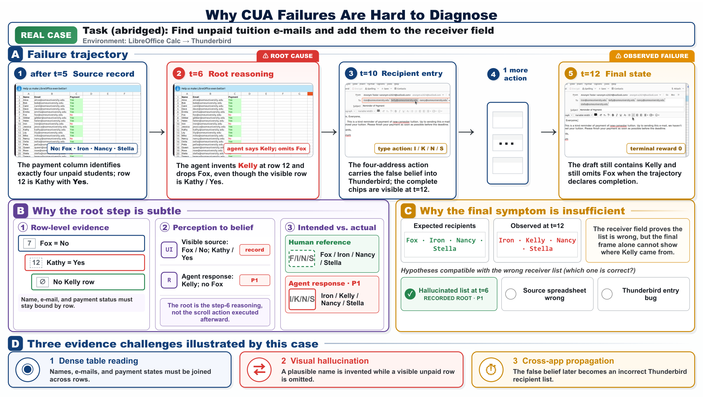

Figure 1: Why CUA failures require root-cause diagnosis rather than terminal-state inspection.

Existing agent evaluations report end-to-end task success without localizing the step or cause of failure. Error taxonomies and failure-attribution studies identify recurring agent mistakes ([Zhu et al., 2025](#bib.bib7); [Cemri et al., 2025](#bib.bib8); [Shah et al., 2026](#bib.bib10); [Zhang et al., 2025a](#bib.bib11); [Zhu et al., 2026](#bib.bib12); [Ma et al., 2026](#bib.bib13)), but CUA root-cause analysis must localize a causal step from evidence distributed across screenshots, spatial targets, low-level actions, and temporal screen transitions. Figure [1](#S1.F1) illustrates this temporal gap: the earliest causal error can precede the terminal failure. To address this challenge, we develop CUADebugger, an automatic ReAct-style debugger that uses an iterative tool-use loop to inspect selected trajectory steps using paired before/after screenshots and action traces, then produces a structured root-cause analysis (RCA) record for re-execution.

We evaluate CUADebug through three research questions. First, where do CUA agents fail? We characterize these failures with a CUA-specific taxonomy and human annotations of failed OSWorld trajectories. Second, does CUADebugger’s tool-augmented trajectory inspection improve RCA accuracy over a prompt-only baseline? We compare CUADebugger with a prompt-only baseline that returns the same structured RCA fields, using human annotations as ground truth for taxonomy agreement and root-step localization. Third, can RCA guide re-execution? We evaluate whether diagnostic context improves task completion under single and continual re-rollout protocols.

To evaluate the alignment of an LLM-based RCA judge with human experts, we introduce CUAErrorBench, a human-annotated benchmark of failed OSWorld trajectories. For each failed trajectory, human experts annotate the root-cause step, L1/L2 taxonomy label, supporting evidence, corrective strategy, and confidence. CUAErrorBench enables direct comparison between LLM-generated RCA and human expert judgments at both the taxonomy and root-step levels. Our benchmark contains 204 usable annotations across Claude 4.5 Sonnet, Gemini 2.5 Pro, and Qwen 3.5 trajectory sources.

CUADebugger implements this diagnosis process with two CUA-specific tools (Figure [2](#S1.F2)). Within a ReAct ([Yao et al., 2023](#bib.bib22)) loop, the step-inspection tool returns paired before/after screenshots, actions, reasoning, and execution status for selected steps, while the submission tool records a coarse-to-fine taxonomy label, grounded evidence, a concrete correction, confidence, and per-step summaries for re-rollout. When episodic memory is enabled, CUADebugger retrieves diagnoses distilled from prior debugging episodes as candidate evidence for the current RCA. CUADebugger passes the predicted root-cause step, grounded evidence, and correction to the re-rollout agent. Re-rollout task completion then measures whether this diagnostic context supports repair.

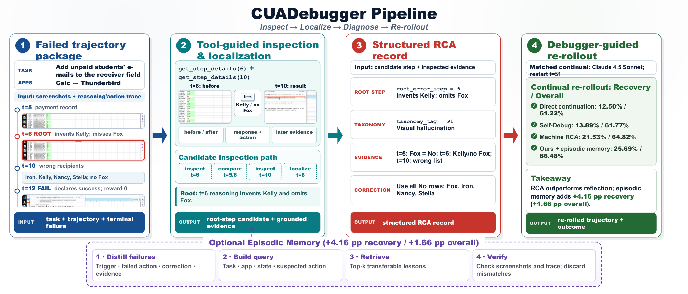

Figure 2: CUADebugger inspects failed trajectories, produces structured RCA, retrieves relevant memories, and guides re-rollout.

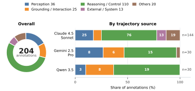

Figure 3: CUAErrorBench annotation distribution by trajectory source.

First, task reasoning and control accounts for the largest share of human-annotated failures (110/204), while the remaining cases span perception, grounding/interaction, external/system, and Others (Figure [3](#S1.F3)). Second, CUADebugger improves L2 and Tag+Step Exact over the prompt-only baseline for all three debugger backbones on the Claude-agent split; with Gemini 2.5 Pro, Tag+Step Exact increases from 11.1% to 19.4%. Third, in the single re-execution package comparison, CUADebugger achieves 29.86% task completion versus 13.89% for history-only continuation (68.14% versus 61.77% Overall Acc); under the more controlled continual protocol, it achieves 25.69% versus 12.50% (66.48% versus 61.22% Overall Acc), while human-oracle guidance reaches 29.17% (67.87% Overall Acc).

We make three contributions. First, we characterize CUA failures with a root-cause taxonomy comprising five categories and 30 subtypes (Table [1](#S2.T1)). Second, we introduce CUAErrorBench, a benchmark with human root-cause annotations for 204 failed OSWorld trajectories. Third, we develop CUADebugger, an automatic ReAct-style RCA agent that actively selects trajectory steps for multimodal inspection, submits structured diagnoses, and optionally retrieves prior debugging episodes; we evaluate its RCA against human annotations and its corrections through re-execution.

## 2 CUAErrorBench

We construct CUAErrorBench from failed OSWorld trajectories generated by three CUA configurations. Each trajectory contains a task instruction, visual observations, screenshots, model reasoning traces, low-level actions, rewards, and terminal status. CUAErrorBench contains 204 annotated trajectories: 144 generated by Claude 4.5 Sonnet with a 50-step budget, 30 by Gemini 2.5 Pro, and 30 by Qwen 3.5. Figure [3](#S1.F3) summarizes the category distribution across trajectory sources; task reasoning and control is the largest category (110/204).

The annotation pipeline stores debugger-generated RCA proposals alongside human annotations, which serve as ground truth for evaluating taxonomy agreement and root-step localization. For each failed trajectory, annotators record five fields: the root-cause step, L1/L2 taxonomy label, supporting evidence, corrective strategy, and confidence. Across all 204 cases ( $N=204$ ), two annotators separately recorded first-pass annotations before discussion. The pre-adjudication exact-agreement rates were 85.8% for the root-cause step, 94.6% for the L1 category, and 85.8% for the L2 subtype. Disagreements were adjudicated to produce one ground-truth annotation per trajectory. Appendix [A.3](#A1.SS3) provides the annotation instructions and consent procedure; Appendix [A.4](#A1.SS4) presents a complete annotated case.

#### Benchmark curation and annotation protocol.

To verify each RCA proposal, annotators inspect the task instruction, terminal failure signal, action and reasoning trace, and before/after screenshots. They verify the terminal failure and trace backward to the earliest step that introduces a new causal error, excluding steps that merely inherit an earlier mistake. Supporting evidence must cite concrete trajectory observations, such as the visible UI state, selected element, executed action, or a mismatch between the agent’s stated intention and the resulting screen state. The correction specifies an alternative action at the root-cause step, and confidence reflects whether competing explanations remain plausible.

#### Taxonomy labels.

The two-level CUA taxonomy provides a shared label space for automatic RCA, human evaluation, and memory indexing. The top-level label identifies the causal module, while the subtype specifies the failure pattern used for fine-grained evaluation and memory indexing. Table [1](#S2.T1) defines the five top-level categories, and Appendix [A.5](#A1.SS5) lists all 30 subtypes.

| Code | Error module | Diagnostic question | Typical evidence |
| --- | --- | --- | --- |
| P | Perception | Did the agent misunderstand what was visible in the observation? | Hallucinated or missed UI content, OCR mistakes, cross-region binding errors, semantic misreadings. |
| G | Grounding and Interaction | Did the agent know the intended operation but execute it on the wrong target or with the wrong mechanics? | Wrong coordinates or element, hidden or disabled target, incorrect click, drag, gesture, or text-entry behavior. |
| R | Task Reasoning and Control | Did the agent choose, maintain, or revise the wrong plan? | Constraint violations, missing subgoals, action-intent mismatch, memory loss, progress misjudgment, failed self-correction. |
| S | External/System | Did the environment, tool, or benchmark setup prevent otherwise valid progress? | Rendering or timing failures, unexpected system dialogs, resource limits, tool/API failures, benchmark artifacts. |
| O | Others | Does the failure fall outside the four execution modules above? | Cases not attributable to P/G/R/S. |

Table 1: Top-level CUA error taxonomy used in CUAErrorBench.

## 3 Method

CUADebugger diagnoses and repairs CUA failures through three components: tool-augmented RCA, optional episodic-memory retrieval, and debugger-guided re-rollout.

### 3.1 Root-Cause Analysis

RCA localizes the earliest causal step in a failed trajectory and produces a structured diagnosis. CUADebugger runs a ReAct ([Yao et al., 2023](#bib.bib22)) loop that iteratively selects trajectory steps and invokes CUA-specific tools to inspect their multimodal evidence. The RCA agent receives the task instruction, trajectory metadata, terminal failure step $F$ , L1/L2 taxonomy definitions, and output schema; retrieved memories are added as candidate evidence only when memory is enabled. At each turn, the agent selects the next step to inspect, retains a textual observation note, and removes older screenshots from the context window.

#### Multimodal step-inspection tool.

get\_step\_details $(n)$  returns the action, reasoning trace, execution error, reward, and screenshots immediately before and after step $n$ . Comparing the before/after screenshots with the agent’s stated intention reveals perception, grounding, and outcome-misinterpretation errors.

#### Structured root-cause submission tool.

The agent terminates by calling finish $(\cdot)$ . The finish schema requires the root-cause step $N$ , an L1/L2 taxonomy label, grounded evidence, a concrete correction, confidence in $[0,1]$ , and a summary of each inspected step. These summaries, together with the predicted root-cause step, taxonomy label, evidence, and correction, form the diagnostic context passed to re-rollout (Section [3.5](#S3.SS5)).

#### Memory retrieval.

When episodic memory is enabled, the RCA prompt includes the top- $k$ retrieved memories as candidate evidence; the agent compares each trigger condition with the current trajectory and discards mismatches. Appendix [A.1](#A1.SS1) provides the RCA prompt template, memory-retrieval block, and tool schemas.

### 3.2 Error Taxonomy Module

The error taxonomy module makes RCA a coarse-to-fine diagnosis. For each candidate root-cause step, the debugger selects one of five top-level modules (Table [1](#S2.T1)) and then a subtype within that module (Appendix [A.5](#A1.SS5)). The top-level label identifies the causal source used to guide re-rollout, while the subtype supports memory indexing and fine-grained evaluation.

### 3.3 Multimodal Trajectory Inspection

CUADebugger analyzes the before/after screenshots and corresponding action trace from each inspected step as paired causal evidence. For each inspected step, the debugger records the pre-action screen state, intended UI operation, executed low-level action, and resulting screen state. These paired observations reveal errors such as selecting the wrong chart subtype, clicking a nearby control, or assuming that a dialog changed state when the resulting screenshot shows otherwise. The debugger uses the resulting step summaries for RCA, memory distillation, and re-rollout.

### 3.4 Episodic Memory and Retrieval-Augmented Debugging

Episodic memory converts individual trajectories into reusable debugging knowledge. For each failed trajectory, CUADebugger stores an episode containing task and application metadata, local error context, inferred agent intention, screen outcome, taxonomy label, and RCA output. During retrieval, CUADebugger returns the distilled rule together with the supporting trajectory evidence stored in the episode.

Retrieval-augmented debugging exposes this memory through a tool-use interface. From each episode, CUADebugger distills a memory record containing a title, trigger condition, failed and corrected actions, taxonomy label, distinguishing feature, supporting evidence, and source-episode references. Memories are indexed by application identifier, taxonomy label, trigger condition, failed action, and memory text. During RCA or re-rollout, the debugger or acting agent retrieves similar failures as candidate evidence and compares their trigger conditions and distinguishing features with the current screenshots and action trace. At cold start, the memory is empty; it then grows from successful RCA outputs and contrastive failure/success trajectory pairs. We evaluate the contribution of memory through a staged comparison between Machine RCA without retrieval and the memory-enabled variant.

Algorithm [1](#algorithm1) summarizes memory construction and retrieval for RCA and re-rollout.

Algorithm 1 Building and querying episodic memory for RCA and re-rollout.

Input: Prior debugging episodes $\mathcal{D}_{mem}$ , target trajectory $\tau$ , retrieval size $k$ , mode $m\in\{\mathrm{RCA},\mathrm{re\mbox{-}rollout}\}$

Output: An RCA report or re-rollout guidance

$M\leftarrow\emptyset$

for  *$\tau_{i}\in\mathcal{D}_{mem}$*  do

$r_{i}\leftarrow\textsc{RunRCA}(\tau_{i})$

if  *$r_{i}$ contains a root step, tag, evidence, and correction* then

$e_{i}\leftarrow\textsc{BuildEpisode}(\tau_{i},r_{i})$

if *a corrected re-rollout $\tau_{i}^{+}$ exists* then

attach the failure/success contrast from $(\tau_{i},\tau_{i}^{+})$ to $e_{i}$

end if

$M.\textsc{Add}(\textsc{DistillMemory}(e_{i}))$

end if

end for

$q\leftarrow\textsc{BuildQuery}(\tau,m)$

$L\leftarrow\texttt{memory\_query}(M,q,k)$

$C\leftarrow\{\ell\in L:\textsc{Match}(\ell,\tau)\}$

if  *$m=\mathrm{RCA}$*  then

return $\textsc{Diagnose}(\tau,C)$

end if

return $\textsc{BuildRepairGuidance}(\tau,C)$

### 3.5 Debugger-Guided Re-Rollout

Re-rollout measures whether diagnostic context improves subsequent task execution. Both the direct baseline and the debugger-guided method replay the original OSWorld trajectory to the same cutoff state and continue with the same remaining step budget. With state and budget fixed, the debugger-guided condition adds the previous trajectory summary, inspected-step summaries, and a repair recipe containing the predicted root-cause step, taxonomy label, evidence, and correction to the acting prompt. In the retrieval-enabled variant, the acting agent can additionally query episodic memory for similar prior failures before choosing its next action. Appendix [A.2](#A1.SS2) lists the re-rollout prompt variants and visual side-channel tools.

We measure whether diagnostic context supports behavioral repair during re-rollout using task completion and root-error repair.

## 4 Experiments

### 4.1 Evaluation Protocol

We evaluate CUA debugging along three research questions. First, failure analysis asks where CUA agents fail by measuring the human-labeled distribution of root-cause modules across trajectory sources. Second, RCA evaluation asks whether CUADebugger improves over a naive prompt baseline and matches human root-cause judgments. Third, re-rollout evaluation asks whether RCA can guide subsequent execution. Unless otherwise stated, human annotations are the reference labels. We compute Acc over the failed trajectories sent to re-execution and Overall Acc over all 361 tasks, counting both initial successes and recovered failures.

### 4.2 Failure Analysis

Failure analysis uses the human labels in CUAErrorBench to characterize where CUA agents fail. We report top-level taxonomy distributions by agent trajectory source in Figure [3](#S1.F3). This analysis answers a descriptive question rather than a model-ranking question: it provides the reference view of CUA failure modes against which model debugger behavior is later compared.

### 4.3 RCA Evaluation

The RCA evaluation reports both taxonomy and localization accuracy. We compare two RCA methods. The *Naive Baseline* receives the task, full trajectory package, and taxonomy definitions, and produces the RCA record in one pass. CUADebugger receives the same task metadata and taxonomy definitions but must use the step-inspection and structured-submission tools described in Section [3.1](#S3.SS1) to inspect step details before producing the same RCA record. Table [2](#S4.T2) reports both methods. L1 accuracy measures top-level taxonomy agreement with the human annotation, while L2 accuracy measures exact subtype agreement. Step Exact measures exact root-cause-step match, and Step $\pm 2$ gives credit when the predicted root-cause step is within two steps of the human-labeled root-cause step. Tag+Step Exact requires both L2 subtype match and exact root-cause-step match.

| Agent traj. | RCA method | Debugger | L1 | L2 | Step Exact | Step $\pm$ 2 | Tag+ Step |
| --- | --- | --- | --- | --- | --- | --- | --- |
| Claude 4.5 | Naive | Gemini 2.5 Pro | 50.7 | 29.9 | 20.8 | 38.2 | 11.1 |
| Claude 4.5 | CUADebug | Gemini 2.5 Pro | 53.5 | 36.8 | 29.2 | 47.9 | 19.4 |
| Claude 4.5 | Naive | Qwen 3.5 | 44.4 | 19.4 | 23.6 | 34.7 | 7.6 |
| Claude 4.5 | CUADebug | Qwen 3.5 | 57.6 | 33.3 | 25.0 | 46.5 | 14.6 |
| Claude 4.5 | Naive | Claude 4.5 | 49.3 | 14.6 | 22.2 | 38.2 | 4.9 |
| Claude 4.5 | CUADebug | Claude 4.5 | 61.1 | 31.3 | 29.2 | 45.1 | 15.3 |
| Gemini 2.5 Pro | Naive | Qwen 3.5 | 46.7 | 20.0 | 26.7 | 50.0 | 6.7 |
| Gemini 2.5 Pro | CUADebug | Qwen 3.5 | 43.3 | 20.0 | 23.3 | 40.0 | 3.3 |
| Gemini 2.5 Pro | Naive | Claude 4.5 | 53.3 | 23.3 | 26.7 | 50.0 | 10.0 |
| Gemini 2.5 Pro | CUADebug | Claude 4.5 | 43.3 | 23.3 | 33.3 | 50.0 | 16.7 |
| Gemini 2.5 Pro | Naive | Gemini 2.5 Pro | 50.0 | 20.0 | 30.0 | 40.0 | 10.0 |
| Gemini 2.5 Pro | CUADebug | Gemini 2.5 Pro | 53.3 | 16.7 | 40.0 | 50.0 | 10.0 |
| Qwen 3.5 | Naive | Gemini 2.5 Pro | 53.3 | 23.3 | 33.3 | 43.3 | 10.0 |
| Qwen 3.5 | CUADebug | Gemini 2.5 Pro | 53.3 | 36.7 | 46.7 | 63.3 | 16.7 |
| Qwen 3.5 | Naive | Qwen 3.5 | 46.7 | 20.0 | 16.7 | 33.3 | 3.3 |
| Qwen 3.5 | CUADebug | Qwen 3.5 | 43.3 | 20.0 | 20.0 | 36.7 | 13.3 |
| Qwen 3.5 | Naive | Claude 4.5 | 56.7 | 30.0 | 30.0 | 36.7 | 10.0 |
| Qwen 3.5 | CUADebug | Claude 4.5 | 46.7 | 36.7 | 26.7 | 36.7 | 10.0 |

Table 2: RCA accuracy against human annotations (percent). Claude-agent results use $N=144$ ; Gemini- and Qwen-agent results use $N=30$ . CUADebug denotes our tool-augmented RCA method; Tag+Step requires exact subtype and exact root-cause-step match.

### 4.4 Single Re-Rollout Evaluation

Single re-rollout isolates whether a diagnosis can support behavioral repair. The rollout agent restarts one step before the root-cause step and runs with a fixed step and token budget. The Machine RCA condition uses the machine-predicted root-cause step and machine-generated diagnosis without memory retrieval to test the automatic RCA-to-repair pipeline, while the baseline, self-debug, human-oracle, and our method conditions use the human-labeled root-cause step to fix the restart point and compare diagnostic context. This controls for localization error: if the restart step itself is wrong, the re-rollout may be uninformative regardless of the debugging method. Because the rows differ in diagnostic prompt format, Table [3](#S4.T3) should be read as a re-execution-package comparison rather than a clean ablation of RCA source quality. The main root-error metric is New+Fixed: a post-analysis judge compares the original human annotation, including root-cause step, evidence, and correction, against the new trajectory; the first number counts cases where the original critical error is fixed but a new critical error appears, and the second counts cases where the original critical error is fixed without a new critical error. When the budget reaches a task-level outcome we additionally report Re-rollout Acc as task completion rate. The agent trajectory and rollout agent are fixed to Claude 4.5 Sonnet, and Machine RCA diagnoses are produced by Gemini 2.5 Pro.

| Condition |  | Cost |  |  | Task |  | Root error |
| --- | --- | --- | --- | --- | --- | --- | --- |
| Method | RCA source | Avg. turns | Input tok. | Output tok. | Acc. (%) | Overall Acc. (%) | New+ Fixed |
| Baseline | none | 28.01 | 272.7K | 3.5K | 13.89 | 61.77 | 20+11 |
| Self-debug | self | 31.53 | 324.4K | 3.9K | 15.28 | 62.33 | 22+14 |
| Machine RCA | machine RCA | 23.03 | 290.8K | 2.9K | 28.47 | 67.59 | 40+25 |
| Human oracle | human annotation | 22.37 | 296.9K | 3.7K | 31.94 | 68.98 | 46+29 |
| Our method | RCA + memory | 28.28 | 319.1K | 2.9K | 29.86 | 68.14 | 43+24 |

Table 3: Single re-rollout results on Claude 4.5 Sonnet trajectories. Overall Acc adds recovered failures to 203 initial successes over 361 tasks.

### 4.5 Continual Re-Rollout Evaluation

Continual re-rollout tests whether diagnostic context helps an agent continue after failure. We use Claude 4.5 Sonnet 50-step failures, restart Claude 4.5 Sonnet from step 51, and compare direct continuation, self-debugging, Machine RCA, our full method, and human annotation guidance. Machine RCA diagnoses are produced by Gemini 2.5 Pro. Re-rollout accuracy measures whether the task is completed after re-execution, while New+Fixed uses the same order as Table [3](#S4.T3): fixed with a new critical error, followed by fixed without a new critical error.

| Method | Original turn | Avg. turns | Input tok. | Output tok. | Acc. | Overall Acc. (%) | New+ Fixed |
| --- | --- | --- | --- | --- | --- | --- | --- |
| Baseline | 50 | 38.92 | 390.3K | 3.8K | 12.50 | 61.22 | 18+15 |
| Self-debug | 50 | 43.76 | 401.6K | 4.4K | 13.89 | 61.77 | 20+12 |
| Machine RCA | 50 | 47.13 | 405.9K | 5.1K | 21.53 | 64.82 | 31+19 |
| Our method | 50 | 47.44 | 426.2K | 5.4K | 25.69 | 66.48 | 37+23 |
| Human oracle | 50 | 45.75 | 419.1K | 4.8K | 29.17 | 67.87 | 42+25 |

Table 4: Continual re-rollout results on Claude 4.5 Sonnet failures. Overall Acc adds recovered failures to 203 initial successes over 361 tasks.

## 5 Results and Analysis

#### CUA failures are concentrated in reasoning/control but remain multimodal.

Figure [3](#S1.F3) shows that task reasoning and control accounts for the largest share of human-labeled failures in the active benchmark (110/204, 53.9%). This pattern is consistent across the three trajectory sources: Claude 4.5 Sonnet has 76 reasoning/control failures out of 144 annotations, Gemini 2.5 Pro has 15 out of 30, and Qwen 3.5 has 19 out of 30. The remaining failures span perception (36), grounding/interaction (25), external/system (13), and Others (20). This distribution motivates a CUA-specific taxonomy that explicitly separates visual perception, spatial interaction, reasoning/control, and system causes, plus an Others category for failures outside these four modules.

#### CUADebugger improves joint diagnosis on the main annotated split.

Table [2](#S4.T2) shows that the tool-augmented RCA agent improves RCA on the 144-case Claude 4.5 Sonnet split. Relative to the naive prompt baseline, CUADebugger improves L2 accuracy and Tag+Step Exact for all three debugger backbones. Gemini 2.5 Pro improves from 29.9% to 36.8% L2 accuracy and from 11.1% to 19.4% Tag+Step Exact; Qwen 3.5 improves from 19.4% to 33.3% L2 and from 7.6% to 14.6% Tag+Step; Claude 4.5 Sonnet improves from 14.6% to 31.3% L2 and from 4.9% to 15.3% Tag+Step. Under OSWorld’s three-step visual-history setting, the full tool-augmented inspection package outperforms the Naive baseline. Because the conditions differ in both visual interface and interaction protocol, this comparison does not isolate active step selection or paired screenshots.
Figure [4](#S5.F4) further shows where CUADebugger, using Gemini 2.5 Pro as the debugger, agrees with human labels at the category level on Claude 4.5 Sonnet trajectories. Appendix [A.7](#A1.SS7) reports the corresponding subtype-frequency comparison under the same trial.

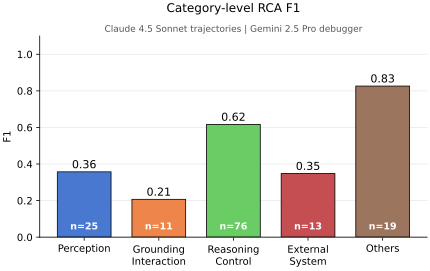

Figure 4: Category-level RCA F1 for the CUADebugger trial using Gemini 2.5 Pro as the debugger on Claude 4.5 Sonnet trajectories (144-task split), including the Others (O) category.

#### Cross-agent RCA remains an important stress test.

The Gemini-agent and Qwen-agent rows show that RCA behavior changes with both the failed agent and debugger backbone. Unlike the Claude split, CUADebugger is not uniformly better on every cross-agent row; for example, Qwen 3.5 on Gemini-agent trajectories has a higher Tag+Step score under the naive baseline than under CUADebugger, while Gemini 2.5 Pro on Qwen-agent trajectories benefits from CUADebugger. These mixed rows also highlight a dependency of CUADebugger on the underlying model’s capability: tool inspection can surface the relevant evidence, but the model must still interpret that evidence and revise its causal hypothesis. Stronger backbones appear better able to turn inspected evidence into corrected diagnoses, whereas weaker backbones may show limited gains or no improvement on small cross-agent splits. Because each cross-agent split contains only 30 trajectories, we treat these rows as a stress test rather than as a final model ranking. Across settings, Tag+Step remains low, confirming that matching both the fine-grained cause and the exact root step is substantially harder than predicting a coarse error family.

#### Single re-rollout: structured RCA improves behavioral repair.

Table [3](#S4.T3) measures whether a diagnosis lets the rollout agent fix the original root-cause mistake. Machine RCA and our method reach 28.47% and 29.86% Re-rollout Acc, compared with 13.89% for the history-only baseline and 15.28% for self-debug. Across all 361 tasks, the corresponding Overall Acc values are 61.77% for the baseline, 62.33% for self-debug, 67.59% for Machine RCA, 68.14% for our method, and 68.98% for the human oracle. In root-error outcomes, the same root error is fixed but followed by a new error in 40 Machine RCA cases and 43 our-method cases, and is fixed without a new critical error in 25 and 24 cases respectively. This repair setting reflects the same capability dependence as RCA: pointing out the root error is most useful when the rollout model can translate the diagnosis into a different action sequence; weaker models may still repeat the failure or only partially avoid it. Because restart source and diagnostic prompt format differ across rows, Table [3](#S4.T3) compares re-execution packages rather than isolating diagnosis quality.

#### Continual re-rollout benefits from accurate RCA.

Table [4](#S4.T4) reports continual re-rollout from Claude 4.5 Sonnet 50-step failures. Direct continuation, self-debug, Machine RCA, our method, and human-oracle guidance reach 12.50%, 13.89%, 21.53%, 25.69%, and 29.17% task success, respectively; their Overall Acc values are 61.22%, 61.77%, 64.82%, 66.48%, and 67.87%. Our method fixes the first critical error in 60 cases (37 with a new critical error and 23 without), compared with 33 cases for the baseline and 32 for self-debug.

#### Why human annotation: evolved taxonomies are path-dependent.

We evaluate a self-evolving taxonomy with an empty-start, serial protocol over the pre-filter 144-case Claude 4.5 Sonnet 50-step pool. For each case, Gemini 2.5 Pro actively inspects trajectory steps in a ReAct-style loop, produces an RCA, and commits one state operation: reuse an existing subtype, append a new subtype, refine a subtype definition, split a subtype, or merge subtypes. The validated taxonomy state is then passed to the next case, so each random case ordering induces its own evolution path. We run four random case orderings; seed 3 covers all 144 cases on a paid API quota, with 136 successful outputs and eight max-turn failures, while seeds 0 to 2 each cover 47 to 55 cases before truncation. Three findings emerge. (A) Evolved taxonomies do not converge across orderings. Across the $\binom{4}{2}=6$ seed pairs, an LLM-as-judge under name-strict alignment finds zero matching subtypes; seed 0 organizes failures as P-\*/OI-\*/I-\*, while seed 3 uses an eight-way ACTION/POLICY/EVALUATOR/VISUAL scheme, and the two cannot be unified by name. (B) The full-coverage seed does not saturate. Seed 3 ends with 40 subtypes after 144 cases with the curve still rising, ruling out a data-quantity explanation for the divergence. (C) Semantic structure partially converges even though naming does not. Projecting each run through a separate LLM-as-judge mapping back into CUAErrorBench’s label space recovers 15% to 28% of human subtypes per seed and roughly 40% in the four-seed union. On the 125-case non-Others subset, the seed 3 self-evolving outputs achieve 16.0% L1, 4.8% L2, and 25.6% Step Exact. The separate 144-case main evaluation of CUADebugger with the human taxonomy reports 53.5% L1, 36.8% L2, and 29.2% Step Exact. The self-evolving results are post-hoc matched metrics from the raw 144-case run: eight max-turn failures and labels mapped to NONE are counted as incorrect, and L1/L2 use Gemini 2.5 Flash projection to the human schema; we therefore treat them as diagnostic rather than as a clean non-Others rerun. We therefore retain the human taxonomy as the canonical schema for evaluation and memory indexing; the self-evolving runs still recover related error structure.

## 6 Related Work

#### Computer-Use Agent Benchmarks.

Recent benchmarks evaluate agents in realistic computer-use environments, including desktop systems, web interfaces, and mobile applications ([Xie et al., 2024](#bib.bib1); [Zhou et al., 2024](#bib.bib2); [Koh et al., 2024](#bib.bib3); [Deng et al., 2023](#bib.bib4); [Rawles et al., 2025](#bib.bib5); [Bonatti et al., 2024](#bib.bib6)). These benchmarks measure end-to-end task success without assigning root-cause labels to failed trajectories. CUAErrorBench complements these benchmarks by adding human root-cause annotations over failed trajectories, which serve as reference labels for evaluating CUADebugger.

#### Agent failure analysis and debugging.

Prior work studies agent failure taxonomies, multi-agent failure attribution, and CUA-specific trust or diagnosis problems ([Cemri et al., 2025](#bib.bib8); [Shah et al., 2026](#bib.bib10); [Zhang et al., 2025a](#bib.bib11); [Zhu et al., 2026](#bib.bib12); [Ma et al., 2026](#bib.bib13); [Liu et al., 2026](#bib.bib9); [Shi et al., 2026](#bib.bib15); [Zhai et al., 2026](#bib.bib14)). Among these methods, AgentErrorBench and AgentDebug are the closest to our setting; they study root-cause debugging for general LLM agents in ALFWorld, GAIA, and WebShop ([Zhu et al., 2025](#bib.bib7)). Our work focuses on the CUA setting, where decisive evidence is often multimodal and interaction-level: screenshots, target grounding, temporal screen transitions, and low-level GUI mechanics. CUADebugger combines CUA-specific human annotations with visual inspection and episodic memory over agent intentions and screen outcomes. We use OSWorld state replay to evaluate the resulting re-execution guidance.

#### Multimodal information flow.

Recent modular multimodal systems decouple visual evidence extraction from downstream reasoning. SeeingEye, for example, uses an agentic vision translator with tools such as OCR and crop to produce structured intermediate representations for text-only LLM reasoning ([Zhang et al., 2025b](#bib.bib20)). CUADebugger applies this separation to causal analysis of failed CUA trajectories.

#### Learning from failure.

Language agents can improve from reflection, experience, retrieval, and memory ([Yao et al., 2023](#bib.bib22); [Shinn et al., 2023](#bib.bib16); [Zhao et al., 2024](#bib.bib18); [Wang et al., 2024](#bib.bib17); [Hu et al., 2026](#bib.bib21)). BacktrackAgent detects errors online and backtracks during task execution ([Wu et al., 2025](#bib.bib19)). We study post-execution causal localization with a human-annotated CUA failure benchmark and a tool-augmented RCA agent. The RCA agent returns a structured diagnosis containing evidence, a taxonomy label, and a correction. We evaluate the correction through controlled re-rollout and store the diagnosis as reusable memory.

## 7 Conclusion

We studied where CUA agents fail, whether a tool-augmented RCA agent improves over the Naive Baseline while matching human root-cause judgments, and whether RCA can guide re-execution. We introduced a CUA-specific taxonomy, the human-annotated failure benchmark CUAErrorBench, and the tool-augmented RCA agent CUADebugger, which produces re-execution guidance. Reasoning/control accounts for 53.9% of benchmark failures, alongside perception and grounding/interaction cases. On the main annotated split, CUADebugger improves joint diagnosis over the Naive Baseline; this comparison evaluates the full tool-augmented RCA package and does not isolate step inspection. RCA-based re-rollout packages improve task recovery under our protocols, and the continual setting approaches the human-oracle result.

## Limitations

Our most complete evidence comes from Claude 4.5 Sonnet failures: the failure analysis, the Naive-vs-CUADebugger RCA comparison, and the single and continual re-rollout experiments. The smaller cross-agent RCA splits show how the method behaves when the trajectory source and debugger backbone change, but they are too limited to support a general backbone ranking. The single re-rollout conditions differ in restart-step source, diagnostic prompt format, and diagnosis source. We therefore treat task accuracy and critical-error outcomes for Baseline, Self-debug, Machine RCA, Human oracle, and CUADebugger as a package comparison rather than a fully matched ablation. Matched re-rollout ablations should test how subtype prediction, exact root-step localization, and evidence quality affect behavioral repair. We annotate and evaluate only on OSWorld. Future work should test CUADebug on other computer-use benchmarks.

## References

- Bonatti et al. (2024)
  R. Bonatti, D. Zhao, F. Bonacci, D. Dupont, S. Abdali, Y. Li, Y. Lu, J. Wagle, K. Koishida, A. Bucker, L. Jang, and Z. Hui
  Windows agent arena: evaluating multi-modal OS agents at scale.
  arXiv preprint arXiv:2409.08264.
  External Links: [Link](https://arxiv.org/abs/2409.08264),
  [Document](https://dx.doi.org/10.48550/arXiv.2409.08264)
  Cited by: [§1](#S1.p1.1),
  [§6](#S6.SS0.SSS0.Px1.p1.1).
- Cemri et al. (2025)
  M. Cemri, M. Z. Pan, S. Yang, L. A. Agrawal, B. Chopra, R. Tiwari, K. Keutzer, A. Parameswaran, D. Klein, K. Ramchandran, M. Zaharia, J. E. Gonzalez, and I. Stoica
  Why do multi-agent LLM systems fail?.
  arXiv preprint arXiv:2503.13657.
  External Links: [Link](https://arxiv.org/abs/2503.13657),
  [Document](https://dx.doi.org/10.48550/arXiv.2503.13657),
  2503.13657
  Cited by: [§1](#S1.p2.1),
  [§6](#S6.SS0.SSS0.Px2.p1.1).
- Deng et al. (2023)
  X. Deng, Y. Gu, B. Zheng, S. Chen, S. Stevens, B. Wang, H. Sun, and Y. Su
  Mind2Web: towards a generalist agent for the web.
  In Advances in Neural Information Processing Systems 36 (NeurIPS 2023), Datasets and Benchmarks Track,
  External Links: [Link](https://papers.neurips.cc/paper_files/paper/2023/hash/5950bf290a1570ea401bf98882128160-Abstract-Datasets_and_Benchmarks.html),
  2306.06070
  Cited by: [§1](#S1.p1.1),
  [§6](#S6.SS0.SSS0.Px1.p1.1).
- Hu et al. (2026)
  Z. Hu, Q. Zhu, R. Zhao, D. Liang, H. Yan, Y. He, and L. Gui
  Beyond rag for agent memory: retrieval by decoupling and aggregation.
  arXiv preprint arXiv:2602.02007.
  Cited by: [§6](#S6.SS0.SSS0.Px4.p1.1).
- Koh et al. (2024)
  J. Y. Koh, R. Lo, L. Jang, V. Duvvur, M. Lim, P. Huang, G. Neubig, S. Zhou, R. Salakhutdinov, and D. Fried
  VisualWebArena: evaluating multimodal agents on realistic visual web tasks.
  In Proceedings of the 62nd Annual Meeting of the Association for Computational Linguistics (Volume 1: Long Papers),
  Bangkok, Thailand, pp. 881–905.
  External Links: [Link](https://aclanthology.org/2024.acl-long.50/),
  [Document](https://dx.doi.org/10.18653/v1/2024.acl-long.50)
  Cited by: [§1](#S1.p1.1),
  [§6](#S6.SS0.SSS0.Px1.p1.1).
- Liu et al. (2026)
  X. Liu, B. He, X. Liu, A. Luo, H. Zhang, and H. Chen
  Visual confused deputy: exploiting and defending perception failures in computer-using agents.
  arXiv preprint arXiv:2603.14707.
  External Links: [Link](https://arxiv.org/abs/2603.14707),
  [Document](https://dx.doi.org/10.48550/arXiv.2603.14707),
  2603.14707
  Cited by: [§6](#S6.SS0.SSS0.Px2.p1.1).
- Ma et al. (2026)
  X. Ma, X. Xie, Y. Wang, J. Wang, B. Wu, M. Li, and Q. Wang
  Demystifying the lifecycle of failures in platform-orchestrated agentic workflows.
  External Links: 2509.23735,
  [Link](https://arxiv.org/abs/2509.23735)
  Cited by: [§1](#S1.p2.1),
  [§6](#S6.SS0.SSS0.Px2.p1.1).
- Rawles et al. (2025)
  C. Rawles, S. Clinckemaillie, Y. Chang, J. Waltz, G. Lau, M. Fair, A. Li, W. Bishop, W. Li, F. Campbell-Ajala, D. Toyama, R. Berry, D. Tyamagundlu, T. Lillicrap, and O. Riva
  AndroidWorld: a dynamic benchmarking environment for autonomous agents.
  In International Conference on Learning Representations,
  External Links: [Link](https://proceedings.iclr.cc/paper_files/paper/2025/hash/01a83bc2f2732a58e6aa731e659e7101-Abstract-Conference.html),
  2405.14573
  Cited by: [§1](#S1.p1.1),
  [§6](#S6.SS0.SSS0.Px1.p1.1).
- Shah et al. (2026)
  M. B. Shah, M. M. Morovati, M. M. Rahman, and F. Khomh
  Characterizing faults in agentic ai: a taxonomy of types, symptoms, and root causes.
  External Links: 2603.06847,
  [Link](https://arxiv.org/abs/2603.06847)
  Cited by: [§1](#S1.p2.1),
  [§6](#S6.SS0.SSS0.Px2.p1.1).
- Shi et al. (2026)
  Y. Shi, W. Yu, J. Huang, W. Yao, W. Chen, and N. Liu
  Towards trustworthy gui agents: a survey.
  External Links: 2503.23434,
  [Link](https://arxiv.org/abs/2503.23434)
  Cited by: [§6](#S6.SS0.SSS0.Px2.p1.1).
- Shinn et al. (2023)
  N. Shinn, F. Cassano, A. Gopinath, K. R. Narasimhan, and S. Yao
  Reflexion: language agents with verbal reinforcement learning.
  In Thirty-seventh Conference on Neural Information Processing Systems,
  External Links: [Link](https://openreview.net/forum?id=vAElhFcKW6)
  Cited by: [§6](#S6.SS0.SSS0.Px4.p1.1).
- Wang et al. (2024)
  G. Wang, Y. Xie, Y. Jiang, A. Mandlekar, C. Xiao, Y. Zhu, L. Fan, and A. Anandkumar
  Voyager: an open-ended embodied agent with large language models.
  Transactions on Machine Learning Research.
  Note: 
  External Links: ISSN 2835-8856,
  [Link](https://openreview.net/forum?id=ehfRiF0R3a)
  Cited by: [§6](#S6.SS0.SSS0.Px4.p1.1).
- Wu et al. (2025)
  Q. Wu, P. Gao, W. Liu, and J. Luan
  Backtrackagent: enhancing gui agent with error detection and backtracking mechanism.
  In Proceedings of the 2025 Conference on Empirical Methods in Natural Language Processing,
  pp. 4250–4272.
  Cited by: [§6](#S6.SS0.SSS0.Px4.p1.1).
- Xie et al. (2024)
  T. Xie, D. Zhang, J. Chen, X. Li, S. Zhao, R. Cao, T. J. Hua, Z. Cheng, D. Shin, F. Lei, Y. Liu, Y. Xu, S. Zhou, S. Savarese, C. Xiong, V. Zhong, and T. Yu
  OSWorld: benchmarking multimodal agents for open-ended tasks in real computer environments.
  In Advances in Neural Information Processing Systems 37 (NeurIPS 2024), Datasets and Benchmarks Track,
  External Links: [Link](https://papers.nips.cc/paper_files/paper/2024/hash/5d413e48f84dc61244b6be550f1cd8f5-Abstract-Datasets_and_Benchmarks_Track.html),
  [Document](https://dx.doi.org/10.52202/079017-1650),
  2404.07972
  Cited by: [§1](#S1.p1.1),
  [§6](#S6.SS0.SSS0.Px1.p1.1).
- Yao et al. (2023)
  S. Yao, J. Zhao, D. Yu, N. Du, I. Shafran, K. Narasimhan, and Y. Cao
  ReAct: synergizing reasoning and acting in language models.
  In International Conference on Learning Representations (ICLR),
  Cited by: [§1](#S1.p5.1),
  [§3.1](#S3.SS1.p1.1),
  [§6](#S6.SS0.SSS0.Px4.p1.1).
- Zhai et al. (2026)
  Y. Zhai, R. Li, L. Wang, N. Shi, L. Xu, W. Zhang, R. Lin, B. Xu, and B. Cui
  GUIDE: interpretable gui agent evaluation via hierarchical diagnosis.
  External Links: 2604.04399,
  [Link](https://arxiv.org/abs/2604.04399)
  Cited by: [§6](#S6.SS0.SSS0.Px2.p1.1).
- Zhang et al. (2025a)
  S. Zhang, M. Yin, J. Zhang, J. Liu, Z. Han, J. Zhang, B. Li, C. Wang, H. Wang, Y. Chen, and Q. Wu
  Which agent causes task failures and when? on automated failure attribution of LLM multi-agent systems.
  In Forty-second International Conference on Machine Learning,
  External Links: [Link](https://openreview.net/forum?id=GazlTYxZss)
  Cited by: [§1](#S1.p2.1),
  [§6](#S6.SS0.SSS0.Px2.p1.1).
- Zhang et al. (2025b)
  W. Zhang, Z. Liu, H. Li, H. Chen, and J. You
  SeeingEye: agentic information flow unlocks multimodal reasoning in text-only llms.
  External Links: 2510.25092,
  [Link](https://arxiv.org/abs/2510.25092)
  Cited by: [§6](#S6.SS0.SSS0.Px3.p1.1).
- Zhao et al. (2024)
  A. Zhao, D. Huang, Q. Xu, M. Lin, Y. Liu, and G. Huang
  ExpeL: llm agents are experiential learners.
  In Proceedings of the Thirty-Eighth AAAI Conference on Artificial Intelligence and Thirty-Sixth Conference on Innovative Applications of Artificial Intelligence and Fourteenth Symposium on Educational Advances in Artificial Intelligence,
  AAAI’24/IAAI’24/EAAI’24.
  External Links: ISBN 978-1-57735-887-9,
  [Link](https://doi.org/10.1609/aaai.v38i17.29936),
  [Document](https://dx.doi.org/10.1609/aaai.v38i17.29936)
  Cited by: [§6](#S6.SS0.SSS0.Px4.p1.1).
- Zhou et al. (2024)
  S. Zhou, F. F. Xu, H. Zhu, X. Zhou, R. Lo, A. Sridhar, X. Cheng, T. Ou, Y. Bisk, D. Fried, U. Alon, and G. Neubig
  WebArena: a realistic web environment for building autonomous agents.
  In International Conference on Learning Representations,
  External Links: [Link](https://proceedings.iclr.cc/paper_files/paper/2024/hash/4410c0711e9154a7a2d26f9b3816d1ef-Abstract-Conference.html),
  2307.13854
  Cited by: [§1](#S1.p1.1),
  [§6](#S6.SS0.SSS0.Px1.p1.1).
- Zhu et al. (2026)
  C. Zhu, S. Hong, J. Wu, K. Chawla, Y. Tang, Y. Yin, N. Wolfe, E. Babinsky, and D. Liu
  RAFFLES: reasoning-based attribution of faults for LLM systems.
  In Proceedings of the 19th Conference of the European Chapter of the Association for Computational Linguistics (Volume 1: Long Papers), V. Demberg, K. Inui, and L. Marquez (Eds.),
  Rabat, Morocco, pp. 7659–7688.
  External Links: [Link](https://aclanthology.org/2026.eacl-long.359/),
  [Document](https://dx.doi.org/10.18653/v1/2026.eacl-long.359),
  ISBN 979-8-89176-380-7
  Cited by: [§1](#S1.p2.1),
  [§6](#S6.SS0.SSS0.Px2.p1.1).
- Zhu et al. (2025)
  K. Zhu, Z. Liu, B. Li, M. Tian, Y. Yang, J. Zhang, P. Han, Q. Xie, F. Cui, W. Zhang, X. Ma, X. Yu, G. Ramesh, J. Wu, Z. Liu, P. Lu, J. Zou, and J. You
  Where LLM agents fail and how they can learn from failures.
  arXiv preprint arXiv:2509.25370.
  External Links: [Link](https://arxiv.org/abs/2509.25370),
  [Document](https://dx.doi.org/10.48550/arXiv.2509.25370),
  2509.25370
  Cited by: [§1](#S1.p2.1),
  [§6](#S6.SS0.SSS0.Px2.p1.1).

## Appendix A Prompts, Annotation Protocol, and Additional Analyses

### A.1 RCA Prompt and Tool Schemas

The RCA methods in Section [3.1](#S3.SS1) use the prompt and tool interfaces below. The implementation sources are debugger/profiling/run\_plain.py, debugger/rca.py, and debugger/tools/\_\_init\_\_.py. The live prompt uses the subtype inventory in Appendix [A.5](#A1.SS5); the schemas below reference that inventory instead of reproducing the full table.

The naive RCA baseline follows OSWorld’s visual-history setting. In one call with no tool access or memory, it receives the task, full textual trajectory, taxonomy table, and result screenshots, then returns the same RCA JSON fields as CUADebugger.

[⬇](data:text/plain;base64,U3lzdGVtOgpZb3UgYXJlIGEgZGVidWdnaW5nIGFzc2lzdGFudCBhbmFseXNpbmcgYSBmYWlsZWQgR1VJLWFnZW50IHRyYWplY3RvcnkuCgpZb3VyIGpvYiBpcyB0byBpZGVudGlmeToKICAoYSkgdGhlIHJvb3QgZXJyb3Igc3RlcDogdGhlIHNpbmdsZSBzdGVwIG51bWJlciB3aGVyZSB0aGUgZmFpbHVyZQogICAgICBvcmlnaW5hdGVzLCBub3QganVzdCB3aGVyZSBpdCBzdXJmYWNlczsKICAoYikgdGhlIHRheG9ub215X3RhZzogdGhlIHN1YnR5cGUgY29kZSBmcm9tIHRoZSB0YXhvbm9teSB0YWJsZSB0aGF0CiAgICAgIGJlc3QgZGVzY3JpYmVzIHRoZSByb290IGNhdXNlLgoKRXJyb3IgVGF4b25vbXk6CltQL0cvUi9TL08gc3VidHlwZSB0YWJsZSBmcm9tIEFwcGVuZGl4IENVQSBFcnJvciBUYXhvbm9teSBTdWJ0eXBlc10KClJldHVybiBPTkxZIGEgc2luZ2xlIHZhbGlkIEFTQ0lJIEpTT04gb2JqZWN0IHdpdGggbm8gbWFya2Rvd24gZmVuY2VzLApubyBwcm9zZSwgYW5kIG5vIHRyYWlsaW5nIHRleHQ6CnsKICAicm9vdF9lcnJvcl9zdGVwIjogW2ludF0sCiAgInRheG9ub215X3RhZyI6IFtzdHI7IG9uZSBzdWJ0eXBlIGNvZGVdLAogICJldmlkZW5jZSI6IFtzdHI7IDEtMiBzZW50ZW5jZXMgY2l0aW5nIGFjdGlvbi9lcnJvci9zdGF0ZSBldmlkZW5jZV0sCiAgImNvcnJlY3Rpb24iOiBbc3RyOyB3aGF0IHRoZSBhZ2VudCBzaG91bGQgaGF2ZSBkb25lIGF0IHRoYXQgc3RlcF0sCiAgImNvbmZpZGVuY2UiOiBbZmxvYXQgYmV0d2VlbiAwIGFuZCAxXQp9CgpVc2VyOgpbdGFzayBpbnN0cnVjdGlvbl0KW2Z1bGwgdGV4dHVhbCB0cmFqZWN0b3J5OiBwZXItc3RlcCBhY3Rpb24gdHlwZSwgYWN0aW9uIGNvZGUsIGVycm9yLAogcmV3YXJkL2RvbmUgc3RhdHVzLCByZWFzb25pbmcsIGFuZCBvcHRpb25hbCB0b29sIHVzZV0KW3Jlc3VsdCBzY3JlZW5zaG90cyBvZiB0aGUgbGFzdCBOIHN0ZXBzLCB3aGVuIGVuYWJsZWRdCgpJZGVudGlmeSB0aGUgcm9vdCBlcnJvciBzdGVwIGFuZCB0YXhvbm9teSB0YWcuIE91dHB1dCBKU09OIG9ubHku)

System:

You are a debugging assistant analysing a failed GUI-agent trajectory.

Your job is to identify:

(a) the root error step: the single step number where the failure

originates, not just where it surfaces;

(b) the taxonomy\_tag: the subtype code from the taxonomy table that

best describes the root cause.

Error Taxonomy:

[P/G/R/S/O subtype table from Appendix CUA Error Taxonomy Subtypes]

Return ONLY a single valid ASCII JSON object with no markdown fences,

no prose, and no trailing text:

{

"root\_error\_step": [int],

"taxonomy\_tag": [str; one subtype code],

"evidence": [str; 1-2 sentences citing action/error/state evidence],

"correction": [str; what the agent should have done at that step],

"confidence": [float between 0 and 1]

}

User:

[task instruction]

[full textual trajectory: per-step action type, action code, error,

reward/done status, reasoning, and optional tool use]

[result screenshots of the last N steps, when enabled]

Identify the root error step and taxonomy tag. Output JSON only.

[⬇](data:text/plain;base64,PHJvbGU+CllvdSBhcmUgYW4gZXhwZXJ0IEdVSSBhZ2VudCB0cmFqZWN0b3J5IGRlYnVnZ2VyLiBVc2UgdGhlIHByb3ZpZGVkIHRvb2xzIHRvCmFuYWx5emUgYSB0cmFqZWN0b3J5IHN0ZXAgYnkgc3RlcCwgdGhlbiBzdWJtaXQgeW91ciBmaW5kaW5ncy4KPC9yb2xlPgoKPHdvcmtmbG93PgoxLiBUaGUgdXNlciBmaXJzdCBtZXNzYWdlIGluY2x1ZGVzIGEgc3RlcCBpbmRleCBzaG93aW5nIGVhY2ggc3RlcCdzIGFjdGlvbl90eXBlLAogICB3aGV0aGVyIGl0IGhhZCBhbiBleGVjdXRpb24gZXJyb3IsIGFuZCB3aGV0aGVyIGEgc2NyZWVuc2hvdCBleGlzdHMuIFVzZSBpdAogICB0byBwaWNrIHdoaWNoIHN0ZXBzIHRvIGluc3BlY3QuCjIuIEZvciBlYWNoIHN1c3BpY2lvdXMgc3RlcCwgc3VjaCBhcyBhIHN0ZXAgd2l0aCBhbiBleGVjdXRpb24gZXJyb3IsIGEgc3RlcCBhZnRlcgogICBhIGZhaWxlZCBzdGVwLCBhIHJlcGVhdGVkIGFjdGlvbiwgb3IgdGhlIHRlcm1pbmFsIHN0ZXAgb2YgYSBmYWlsZWQKICAgdHJhamVjdG9yeSwgY2FsbCBnZXRfc3RlcF9kZXRhaWxzLgozLiBnZXRfc3RlcF9kZXRhaWxzIHJldHVybnMgdGhlIGlucHV0IHNjcmVlbnNob3QgKHdoYXQgdGhlIGFnZW50IHNhdyBiZWZvcmUKICAgYWN0aW5nKSBhbmQgdGhlIHJlc3VsdCBzY3JlZW5zaG90IChzY3JlZW4gc3RhdGUgYWZ0ZXIgdGhlIGFjdGlvbikuIENvbXBhcmUKICAgdGhlbSB0byBpZGVudGlmeSBwZXJjZXB0aW9uLCBncm91bmRpbmcsIGludGVyYWN0aW9uLCBvciBvdXRjb21lIGVycm9ycy4KNC4gTG9vayBmb3IgcGF0dGVybnMgYWNyb3NzIHN0ZXBzOiByZXBlYXRlZCBlcnJvcnMgd2l0aG91dCBjb3JyZWN0aW9uLCBzdGFsZQogICB2YXJpYWJsZSByZWZlcmVuY2VzLCB3cm9uZyBVSSB0YXJnZXRzLCBvciBhbiBlbnZpcm9ubWVudCB0aGF0IHdhcyBub3QgcmVhZHkuCjUuIFdoZW4geW91IGhhdmUgaW5zcGVjdGVkIGFsbCByZWxldmFudCBzdGVwcywgY2FsbCBmaW5pc2goKSB3aXRoIHRoZSBjb21wbGV0ZQogICBzdHJ1Y3R1cmVkIFJDQSByZWNvcmQuCjwvd29ya2Zsb3c+Cgo8dGF4b25vbXk+ClVzZSB0aGUgQ1VBIHRheG9ub215IGFwcGVuZGl4OiBQLCBHLCBSLCBTLCBhbmQgTyB0b3AtbGV2ZWwgbGFiZWxzIHdpdGggdGhlaXIKZmluZS1ncmFpbmVkIHN1YnR5cGUgY29kZXMuCjwvdGF4b25vbXk+Cgo8YW5ub3RhdGlvbl9ydWxlcz4KLSBMYWJlbCB0aGUgcm9vdC1jYXVzZSBlcnJvciwgZXZlbiB3aGVuIGRvd25zdHJlYW0gZWZmZWN0cyBtYW5pZmVzdCBkaWZmZXJlbnRseS4KLSBQZXJjZXB0aW9uIHZzLiBHcm91bmRpbmc6IG1pc3VuZGVyc3RhbmRpbmcgdmlzaWJsZSBjb250ZW50IGlzIFA7IHVuZGVyc3RhbmRpbmcKICB0aGUgY29udGVudCBidXQgdGFyZ2V0aW5nIHRoZSB3cm9uZyBsb2NhdGlvbiBvciBpbnRlcmFjdGluZyBpbmNvcnJlY3RseSBpcyBHLgotIFByZWZlciBmaW5lLWdyYWluZWQgc3VidHlwZSBjb2RlcyAoUDEsIEcyLCBSMTAsIFM0LCBldGMuKS4KPC9hbm5vdGF0aW9uX3J1bGVzPgoKIyMgUkNBIE1vZGU6IEZpbmQgdGhlIFNpbmdsZSBSb290IEVycm9yIFN0ZXAKCllvdXIgdGFzayBpcyBSb290IENhdXNlIEFuYWx5c2lzLCBub3QgZ2VuZXJhbCBkZWJ1Z2dpbmcuCgpHb2FsOiBpZGVudGlmeSB0aGUgc2luZ2xlIGVhcmxpZXN0IHN0ZXAgTiBzdWNoIHRoYXQgTiA8PSBGLCB3aGVyZSBGIGlzIHRoZQpUZXJtaW5hbCBGYWlsdXJlIFN0ZXAgKHRoZSBsYXN0IHN0ZXAgb2YgYSBmYWlsZWQgdHJhamVjdG9yeSksIGFuZCB0aGUgbWlzdGFrZSBhdApzdGVwIE4gaXMgdGhlIGRpcmVjdCBjYXVzZSBvZiBzdWJzZXF1ZW50IGZhaWx1cmVzLgoKQmFja3dhcmQtdHJhY2luZyBwcm9jZWR1cmU6CjEuIFVzZSBnZXRfc3RlcF9kZXRhaWxzIHRvIGluc3BlY3Qgc3RlcHMuIEl0IHJldHVybnMgdGV4dHVhbCBkZXRhaWxzIHBsdXMgdGhlCiAgIGlucHV0IHNjcmVlbnNob3QgYW5kIHJlc3VsdCBzY3JlZW5zaG90LgoyLiBJZGVudGlmeSBGID0gdGhlIHRlcm1pbmFsIGZhaWx1cmUgc3RlcCBmcm9tIHRoZSB0cmFqZWN0b3J5IHN1bW1hcnkuCjMuIFdhbGsgYmFja3dhcmRzIGZyb20gRi4gRm9yIGVhY2ggY2FuZGlkYXRlIHN0ZXAsIGNhbGwgZ2V0X3N0ZXBfZGV0YWlscyB0bwogICBjaGVjayB3aGV0aGVyIGl0IGNvbnRhaW5zIGFuIGluZGVwZW5kZW50IG1pc3Rha2Ugb3IgbWVyZWx5IGluaGVyaXRlZCB0aGUKICAgZmFpbHVyZSBmcm9tIGFuIGVhcmxpZXIgc3RlcC4gQ29tcGFyZSB0aGUgaW5wdXQgc2NyZWVuc2hvdCBhZ2FpbnN0IHRoZQogICBhY3Rpb24gdG8gaWRlbnRpZnkgcGVyY2VwdGlvbiBvciBncm91bmRpbmcgZXJyb3JzLgo0LiBTdG9wIHdoZW4geW91IGZpbmQgdGhlIGVhcmxpZXN0IHN0ZXAgdGhhdCBpbnRyb2R1Y2VkIGEgbmV3IG1pc3Rha2UuIFRoYXQgaXMKICAgc3RlcCBOID0gcm9vdF9lcnJvcl9zdGVwLgo1LiBDYWxsIGZpbmlzaCgpIHdpdGggcm9vdF9lcnJvcl9zdGVwPU4sIHRheG9ub215X3RhZywgZXZpZGVuY2UsIGNvcnJlY3Rpb24sCiAgIGNvbmZpZGVuY2UsIGFuZCBwZXJfc3RlcF9zdW1tYXJpZXMuCgpQZXItc3RlcCBzdW1tYXJpZXMgZm9yIHJlcm9sbG91dDoKRm9yIGV2ZXJ5IHN0ZXAgaW5zcGVjdGVkIHdpdGggZ2V0X3N0ZXBfZGV0YWlscywgaW5jbHVkZSBvbmUgZW50cnkgaW4KcGVyX3N0ZXBfc3VtbWFyaWVzOgotIGludGVudF9zdW1tYXJ5OiBpbmZlciB0aGUgYWdlbnQncyBpbnRlbmRlZCBhY3Rpb24gZnJvbSBhY3Rpb24gY29kZSwgcmVhc29uaW5nLAogIGFuZCB0b29sIHVzZS4KLSBvdXRjb21lX3N1bW1hcnk6IGluZmVyIHRoZSBvYnNlcnZhYmxlIHJlc3VsdCBieSBjb21wYXJpbmcgdGhlIGlucHV0IHNjcmVlbnNob3QKICBhZ2FpbnN0IHRoZSByZXN1bHQgc2NyZWVuc2hvdCBhbmQgdXNpbmcgZXhlY3V0aW9uIG1ldGFkYXRhIG9ubHkgYXMgc3VwcG9ydC4KLSBzdW1tYXJ5X3NvdXJjZTogYWx3YXlzIHNldCB0byAiZGVidWdnZXJfaW5zcGVjdGVkIi4KCkFmdGVyIGVhY2ggZ2V0X3N0ZXBfZGV0YWlscyByZXN1bHQsIHdyaXRlIGEgc2hvcnQgcGxhaW4tdGV4dCBvYnNlcnZhdGlvbiBiZWZvcmUKcmVxdWVzdGluZyBtb3JlIHRvb2xzLiBPbGRlciBzY3JlZW5zaG90cyBtYXkgYmUgY29tcHJlc3NlZCBvdXQgb2YgaGlzdG9yeSwgYnV0CnRoZSB3cml0dGVuIG9ic2VydmF0aW9uIHJlbWFpbnMuCgpDb25maWRlbmNlIGd1aWRhbmNlOgotIDAuOS0xLjA6IGNsZWFyIHNpbmdsZSByb290IGNhdXNlIHdpdGggYSBzdHJvbmcgY2F1c2FsIGNoYWluLgotIDAuNy0wLjg5OiBsaWtlbHkgcm9vdCBjYXVzZSB3aXRoIHNvbWUgYW1iaWd1aXR5LgotIDAuNS0wLjY5OiBtdWx0aXBsZSBwbGF1c2libGUgY2FuZGlkYXRlczsgdGhpcyBpcyB0aGUgYmVzdCBndWVzcy4KLSA8IDAuNTogd2VhayBldmlkZW5jZTsgc3RpbGwgY2FsbCBmaW5pc2ggYW5kIG5vdGUgdGhlIHVuY2VydGFpbnR5Lg==)

<role>

You are an expert GUI agent trajectory debugger. Use the provided tools to

analyze a trajectory step by step, then submit your findings.

</role>

<workflow>

1. The user first message includes a step index showing each step’s action\_type,

whether it had an execution error, and whether a screenshot exists. Use it

to pick which steps to inspect.

2. For each suspicious step, such as a step with an execution error, a step after

a failed step, a repeated action, or the terminal step of a failed

trajectory, call get\_step\_details.

3. get\_step\_details returns the input screenshot (what the agent saw before

acting) and the result screenshot (screen state after the action). Compare

them to identify perception, grounding, interaction, or outcome errors.

4. Look for patterns across steps: repeated errors without correction, stale

variable references, wrong UI targets, or an environment that was not ready.

5. When you have inspected all relevant steps, call finish() with the complete

structured RCA record.

</workflow>

<taxonomy>

Use the CUA taxonomy appendix: P, G, R, S, and O top-level labels with their

fine-grained subtype codes.

</taxonomy>

<annotation\_rules>

- Label the root-cause error, even when downstream effects manifest differently.

- Perception vs. Grounding: misunderstanding visible content is P; understanding

the content but targeting the wrong location or interacting incorrectly is G.

- Prefer fine-grained subtype codes (P1, G2, R10, S4, etc.).

</annotation\_rules>

## RCA Mode: Find the Single Root Error Step

Your task is Root Cause Analysis, not general debugging.

Goal: identify the single earliest step N such that N <= F, where F is the

Terminal Failure Step (the last step of a failed trajectory), and the mistake at

step N is the direct cause of subsequent failures.

Backward-tracing procedure:

1. Use get\_step\_details to inspect steps. It returns textual details plus the

input screenshot and result screenshot.

2. Identify F = the terminal failure step from the trajectory summary.

3. Walk backwards from F. For each candidate step, call get\_step\_details to

check whether it contains an independent mistake or merely inherited the

failure from an earlier step. Compare the input screenshot against the

action to identify perception or grounding errors.

4. Stop when you find the earliest step that introduced a new mistake. That is

step N = root\_error\_step.

5. Call finish() with root\_error\_step=N, taxonomy\_tag, evidence, correction,

confidence, and per\_step\_summaries.

Per-step summaries for rerollout:

For every step inspected with get\_step\_details, include one entry in

per\_step\_summaries:

- intent\_summary: infer the agent’s intended action from action code, reasoning,

and tool use.

- outcome\_summary: infer the observable result by comparing the input screenshot

against the result screenshot and using execution metadata only as support.

- summary\_source: always set to "debugger\_inspected".

After each get\_step\_details result, write a short plain-text observation before

requesting more tools. Older screenshots may be compressed out of history, but

the written observation remains.

Confidence guidance:

- 0.9-1.0: clear single root cause with a strong causal chain.

- 0.7-0.89: likely root cause with some ambiguity.

- 0.5-0.69: multiple plausible candidates; this is the best guess.

- < 0.5: weak evidence; still call finish and note the uncertainty.

[⬇](data:text/plain;base64,UGVyZm9ybSBSb290IENhdXNlIEFuYWx5c2lzIG9uIHRoaXMgZmFpbGVkIHRyYWplY3Rvcnk6CgpbdHJhamVjdG9yeSBzdW1tYXJ5IHdpdGggdGFzaywgYXBwLCBzdGVwIGluZGV4LCB0ZXJtaW5hbCBzdGF0dXMsIGFuZCBmYWlsdXJlIHN0ZXBdCgpUaGUgdHJhamVjdG9yeSBpcyBhbHJlYWR5IGxvYWRlZC4gWW91IGNhbiBkaXJlY3RseSBjYWxsIGdldF9zdGVwX2RldGFpbHMgdG8KaW5zcGVjdCBzdGVwcy4gV29yayBiYWNrd2FyZHMgZnJvbSB0aGUgVGVybWluYWwgRmFpbHVyZSBTdGVwLCB0aGVuIGNhbGwgZmluaXNoKCkKd2l0aCB0aGUgcm9vdF9lcnJvcl9zdGVwLCB0YXhvbm9teV90YWcsIGV2aWRlbmNlLCBjb3JyZWN0aW9uLCBhbmQgY29uZmlkZW5jZS4KCklmIHJldHJpZXZlZCBtZW1vcmllcyBhcmUgYXZhaWxhYmxlOgpCZWxvdyBhcmUgc29tZSBwYXN0IG1lbW9yaWVzIHJldHJpZXZlZCBhcyBwb3RlbnRpYWxseSByZWxldmFudCBiYXNlZCBvbiBzZW1hbnRpYwpzaW1pbGFyaXR5LiBUaGV5IGFyZSBub3QgZ3VhcmFudGVlZCB0byBhcHBseTsgZXZhbHVhdGUgZWFjaCBvbmUgYWdhaW5zdCB0aGUKY3VycmVudCB0cmFqZWN0b3J5IGJlZm9yZSB1c2luZyBpdC4gSWYgbm9uZSBtYXRjaCB0aGUgY3VycmVudCBzaXR1YXRpb24sIGlnbm9yZQp0aGVtIGFuZCByZWFzb24gZnJvbSBzY3JhdGNoLgoKRXhhbXBsZSBrOgpbbWVtb3J5IHRpdGxlLCB0cmlnZ2VyIGNvbmRpdGlvbiwgZmFpbGVkIGFjdGlvbiwgY29ycmVjdGVkIGFjdGlvbiwKZGlzdGluZ3Vpc2hpbmcgZmVhdHVyZSwgZXZpZGVuY2UsIHRheG9ub215IHRhZywgYW5kIHNvdXJjZSBlcGlzb2RlIHJlZmVyZW5jZV0=)

Perform Root Cause Analysis on this failed trajectory:

[trajectory summary with task, app, step index, terminal status, and failure step]

The trajectory is already loaded. You can directly call get\_step\_details to

inspect steps. Work backwards from the Terminal Failure Step, then call finish()

with the root\_error\_step, taxonomy\_tag, evidence, correction, and confidence.

If retrieved memories are available:

Below are some past memories retrieved as potentially relevant based on semantic

similarity. They are not guaranteed to apply; evaluate each one against the

current trajectory before using it. If none match the current situation, ignore

them and reason from scratch.

Example k:

[memory title, trigger condition, failed action, corrected action,

distinguishing feature, evidence, taxonomy tag, and source episode reference]

[⬇](data:text/plain;base64,VG9vbDogZ2V0X3N0ZXBfZGV0YWlscwpEZXNjcmlwdGlvbjoKICBHZXQgZnVsbCBkZXRhaWxzIGZvciBhIHNwZWNpZmljIHN0ZXA6IGFjdGlvbiBjb2RlLCBleGVjdXRpb24gZXJyb3IsIGFnZW50CiAgcmVhc29uaW5nLCByZXdhcmQsIGRvbmUgc3RhdHVzLCBwbHVzIHR3byBzY3JlZW5zaG90czogdGhlIGlucHV0IHNjcmVlbnNob3QKICBiZWZvcmUgdGhlIGFjdGlvbiBhbmQgdGhlIHJlc3VsdCBzY3JlZW5zaG90IGFmdGVyIHRoZSBhY3Rpb24uIEluIFJDQSBtb2RlLAogIHRoZXNlIGRldGFpbHMgYXJlIHVzZWQgdG8gd3JpdGUgaW50ZW50X3N1bW1hcnkgYW5kIG91dGNvbWVfc3VtbWFyeS4KSW5wdXQgc2NoZW1hOgogIHsKICAgICJ0eXBlIjogIm9iamVjdCIsCiAgICAicHJvcGVydGllcyI6IHsKICAgICAgInN0ZXBfbnVtIjogewogICAgICAgICJ0eXBlIjogImludGVnZXIiLAogICAgICAgICJkZXNjcmlwdGlvbiI6ICJUaGUgc3RlcCBudW1iZXIgdG8gaW5zcGVjdC4iCiAgICAgIH0KICAgIH0sCiAgICAicmVxdWlyZWQiOiBbInN0ZXBfbnVtIl0KICB9CgpUb29sOiBmaW5pc2gKRGVzY3JpcHRpb246CiAgU3VibWl0IHRoZSBmaW5hbCBSQ0EgcmVzdWx0IGFmdGVyIGlkZW50aWZ5aW5nIHRoZSByb290IGVycm9yIHN0ZXAuCklucHV0IHNjaGVtYToKICB7CiAgICAidHlwZSI6ICJvYmplY3QiLAogICAgInByb3BlcnRpZXMiOiB7CiAgICAgICJyb290X2Vycm9yX3N0ZXAiOiB7CiAgICAgICAgInR5cGUiOiAiaW50ZWdlciIsCiAgICAgICAgImRlc2NyaXB0aW9uIjogIkVhcmxpZXN0IHJvb3QtY2F1c2Ugc3RlcCBOLCB3aGVyZSBOIDw9IHRlcm1pbmFsIHN0ZXAgRi4iCiAgICAgIH0sCiAgICAgICJ0YXhvbm9teV90YWciOiB7CiAgICAgICAgInR5cGUiOiAic3RyaW5nIiwKICAgICAgICAiZW51bSI6IFsKICAgICAgICAgICJQMSIsICJQMiIsICJQMyIsICJQNCIsICJQNSIsCiAgICAgICAgICAiRzEiLCAiRzIiLCAiRzMiLCAiRzQiLAogICAgICAgICAgIlIxIiwgIlIyIiwgIlIzIiwgIlI0IiwgIlI1IiwgIlI2IiwgIlI3IiwgIlI4IiwKICAgICAgICAgICJSOSIsICJSMTAiLCAiUjExIiwgIlIxMiIsICJSMTMiLAogICAgICAgICAgIlMxIiwgIlMyIiwgIlMzIiwgIlM0IiwgIlM1IiwgIlM2IiwgIlM3IiwKICAgICAgICAgICJPMSIsCiAgICAgICAgICAiUCIsICJHIiwgIlIiLCAiUyIsICJPIgogICAgICAgIF0sCiAgICAgICAgImRlc2NyaXB0aW9uIjogIlByZWZlciBhIGZpbmUtZ3JhaW5lZCBzdWJ0eXBlIGNvZGUuIgogICAgICB9LAogICAgICAiZXZpZGVuY2UiOiB7CiAgICAgICAgInR5cGUiOiAic3RyaW5nIiwKICAgICAgICAiZGVzY3JpcHRpb24iOiAiR3JvdW5kZWQgZXZpZGVuY2UgZnJvbSBhY3Rpb24gY29kZSwgZXJyb3JzLCBvciBzY3JlZW5zaG90cy4iCiAgICAgIH0sCiAgICAgICJjb3JyZWN0aW9uIjogewogICAgICAgICJ0eXBlIjogInN0cmluZyIsCiAgICAgICAgImRlc2NyaXB0aW9uIjogIkNvbmNyZXRlIGFjdGlvbiBvciBzdHJhdGVneSB0aGF0IHNob3VsZCBoYXZlIGJlZW4gdXNlZC4iCiAgICAgIH0sCiAgICAgICJjb25maWRlbmNlIjogewogICAgICAgICJ0eXBlIjogIm51bWJlciIsCiAgICAgICAgIm1pbmltdW0iOiAwLjAsCiAgICAgICAgIm1heGltdW0iOiAxLjAsCiAgICAgICAgImRlc2NyaXB0aW9uIjogIkNvbmZpZGVuY2UgdGhhdCB0aGlzIGlzIHRoZSB0cnVlIHJvb3QtY2F1c2Ugc3RlcC4iCiAgICAgIH0sCiAgICAgICJwZXJfc3RlcF9zdW1tYXJpZXMiOiB7CiAgICAgICAgInR5cGUiOiAiYXJyYXkiLAogICAgICAgICJpdGVtcyI6IHsKICAgICAgICAgICJ0eXBlIjogIm9iamVjdCIsCiAgICAgICAgICAicHJvcGVydGllcyI6IHsKICAgICAgICAgICAgInN0ZXBfbnVtIjogeyJ0eXBlIjogImludGVnZXIifSwKICAgICAgICAgICAgImludGVudF9zdW1tYXJ5IjogeyJ0eXBlIjogInN0cmluZyJ9LAogICAgICAgICAgICAib3V0Y29tZV9zdW1tYXJ5IjogeyJ0eXBlIjogInN0cmluZyJ9LAogICAgICAgICAgICAic3VtbWFyeV9zb3VyY2UiOiB7CiAgICAgICAgICAgICAgInR5cGUiOiAic3RyaW5nIiwKICAgICAgICAgICAgICAiZW51bSI6IFsiZGVidWdnZXJfaW5zcGVjdGVkIl0KICAgICAgICAgICAgfQogICAgICAgICAgfSwKICAgICAgICAgICJyZXF1aXJlZCI6IFsKICAgICAgICAgICAgInN0ZXBfbnVtIiwKICAgICAgICAgICAgImludGVudF9zdW1tYXJ5IiwKICAgICAgICAgICAgIm91dGNvbWVfc3VtbWFyeSIsCiAgICAgICAgICAgICJzdW1tYXJ5X3NvdXJjZSIKICAgICAgICAgIF0KICAgICAgICB9CiAgICAgIH0KICAgIH0sCiAgICAicmVxdWlyZWQiOiBbCiAgICAgICJyb290X2Vycm9yX3N0ZXAiLAogICAgICAidGF4b25vbXlfdGFnIiwKICAgICAgImV2aWRlbmNlIiwKICAgICAgImNvcnJlY3Rpb24iLAogICAgICAiY29uZmlkZW5jZSIsCiAgICAgICJwZXJfc3RlcF9zdW1tYXJpZXMiCiAgICBdCiAgfQ==)

Tool: get\_step\_details

Description:

Get full details for a specific step: action code, execution error, agent

reasoning, reward, done status, plus two screenshots: the input screenshot

before the action and the result screenshot after the action. In RCA mode,

these details are used to write intent\_summary and outcome\_summary.

Input schema:

{

"type": "object",

"properties": {

"step\_num": {

"type": "integer",

"description": "The step number to inspect."

}

},

"required": ["step\_num"]

}

Tool: finish

Description:

Submit the final RCA result after identifying the root error step.

Input schema:

{

"type": "object",

"properties": {

"root\_error\_step": {

"type": "integer",

"description": "Earliest root-cause step N, where N <= terminal step F."

},

"taxonomy\_tag": {

"type": "string",

"enum": [

"P1", "P2", "P3", "P4", "P5",

"G1", "G2", "G3", "G4",

"R1", "R2", "R3", "R4", "R5", "R6", "R7", "R8",

"R9", "R10", "R11", "R12", "R13",

"S1", "S2", "S3", "S4", "S5", "S6", "S7",

"O1",

"P", "G", "R", "S", "O"

],

"description": "Prefer a fine-grained subtype code."

},

"evidence": {

"type": "string",

"description": "Grounded evidence from action code, errors, or screenshots."

},

"correction": {

"type": "string",

"description": "Concrete action or strategy that should have been used."

},

"confidence": {

"type": "number",

"minimum": 0.0,

"maximum": 1.0,

"description": "Confidence that this is the true root-cause step."

},

"per\_step\_summaries": {

"type": "array",

"items": {

"type": "object",

"properties": {

"step\_num": {"type": "integer"},

"intent\_summary": {"type": "string"},

"outcome\_summary": {"type": "string"},

"summary\_source": {

"type": "string",

"enum": ["debugger\_inspected"]

}

},

"required": [

"step\_num",

"intent\_summary",

"outcome\_summary",

"summary\_source"

]

}

}

},

"required": [

"root\_error\_step",

"taxonomy\_tag",

"evidence",

"correction",

"confidence",

"per\_step\_summaries"

]

}

When the RCA prompt includes a lesson table, the debugger exposes three retrieval tools alongside get\_step\_details and finish. Each retrieval tool returns candidate evidence, which the model must verify against the current screenshots and action trace.

[⬇](data:text/plain;base64,VG9vbDogbG9va3VwX2xlc3NvbnNfYnlfdGF4b25vbXkKUHVycG9zZToKICBSZXR1cm4gYWRkaXRpb25hbCBkaXN0aWxsZWQgbGVzc29ucyB0aGF0IHNoYXJlIGEgdGF4b25vbXkgY29kZS4KSW5wdXQ6CiAgdGF4b25vbXlfdGFnOiBzdWJ0eXBlIG9yIHRvcC1sZXZlbCBjb2RlLCBlLmcuICJHMSIgb3IgIlIxMCIKICB0b3Bfazogb3B0aW9uYWwgaW50ZWdlciBpbiBbMSwxMF0sIGRlZmF1bHQgMwoKVG9vbDogc2VhcmNoX2xlc3NvbnNfYnlfYXBwClB1cnBvc2U6CiAgUmV0dXJuIGxlc3NvbnMgZnJvbSBhIHNwZWNpZmljIGFwcCwgb3B0aW9uYWxseSBmaWx0ZXJlZCBieSB0YXhvbm9teS4KSW5wdXQ6CiAgYXBwX2lkOiBhcHBsaWNhdGlvbiBpZGVudGlmaWVyLCBlLmcuICJjaHJvbWUiIG9yICJ2c19jb2RlIgogIHRheG9ub215X3RhZzogb3B0aW9uYWwgc3VidHlwZSBvciB0b3AtbGV2ZWwgY29kZQogIHRvcF9rOiBvcHRpb25hbCBpbnRlZ2VyIGluIFsxLDEwXSwgZGVmYXVsdCAzCgpUb29sOiBmb2xsb3dfZXBpc29kaWNfcmVmClB1cnBvc2U6CiAgUmVzb2x2ZSBhIGxlc3NvbidzIGVwaXNvZGljX3JlZiBpbnRvIGEgY29tcGFjdCBzb3VyY2UtdHJhamVjdG9yeSBzdW1tYXJ5LgpJbnB1dDoKICBlcGlzb2RpY19yZWY6IFVVSUQgc3RyaW5nIGNhcnJpZWQgYnkgYSByZXRyaWV2ZWQgbGVzc29u)

Tool: lookup\_lessons\_by\_taxonomy

Purpose:

Return additional distilled lessons that share a taxonomy code.

Input:

taxonomy\_tag: subtype or top-level code, e.g. "G1" or "R10"

top\_k: optional integer in [1,10], default 3

Tool: search\_lessons\_by\_app

Purpose:

Return lessons from a specific app, optionally filtered by taxonomy.

Input:

app\_id: application identifier, e.g. "chrome" or "vs\_code"

taxonomy\_tag: optional subtype or top-level code

top\_k: optional integer in [1,10], default 3

Tool: follow\_episodic\_ref

Purpose:

Resolve a lesson’s episodic\_ref into a compact source-trajectory summary.

Input:

episodic\_ref: UUID string carried by a retrieved lesson’

### A.2 Re-Rollout Prompt Variants and Tools

The re-rollout variants below replay the original environment to a cutoff state before continuing the task. They differ in diagnostic context; in the single re-rollout experiment, Machine RCA uses its predicted root-cause step, whereas the other conditions use the human-labeled step.

The history-only baseline receives the task and previous action history without RCA-derived context.

[⬇](data:text/plain;base64,UkUtUk9MTE9VVCBDT05URVhUClRhc2s6IFt0YXNrIGluc3RydWN0aW9uXQpQcmV2aW91cyByZXN1bHQgc2NvcmU6IFtzY29yZV0gKHRhcmdldDogMS4wKQoKVGhlIGFnZW50IHByZXZpb3VzbHkgYXR0ZW1wdGVkIHRoaXMgdGFzayBmb3IgW05dIHN0ZXBzIGJ1dCBkaWQgbm90IGNvbXBsZXRlIGl0CnN1Y2Nlc3NmdWxseS4gWW91IGFyZSBjb250aW51aW5nIGZyb20gc3RlcCBbY3V0b2ZmKzFdLgoKUFJFVklPVVMgVFJBSkVDVE9SWSBTVU1NQVJZIChTdGVwcyAxLVtOXSkKICBTdGVwICAxOiBbT0svRVJSLyBdIFthY3Rpb25fY29kZV0KICAgICAgICAgICBFcnJvcjogW2V4ZWN1dGlvbiBlcnJvciwgaWYgYW55XQogIC4uLgoKTk9URTogTm8gcmVwYWlyIHJlY2lwZSBhdmFpbGFibGUgZm9yIHRoaXMgdHJhamVjdG9yeS4KUmV2aWV3IHRoZSBzdGVwIGhpc3RvcnkgYWJvdmUgdG8gaWRlbnRpZnkgd2hhdCB3ZW50IHdyb25nLgoKUkUtUk9MTE9VVCBJTlNUUlVDVElPTlMKLSBUaGUgZW52aXJvbm1lbnQgaXMgbm93IGluIHRoZSBzdGF0ZSBpdCB3YXMgaW4gYWZ0ZXIgc3RlcCBbY3V0b2ZmXS4KLSBZb3UgYXJlIHN0YXJ0aW5nIGZyb20gc3RlcCBbY3V0b2ZmKzFdLgotIENvbXBsZXRlIHRoZSB0YXNrIGFzIGVmZmljaWVudGx5IGFzIHBvc3NpYmxlLg==)

RE-ROLLOUT CONTEXT

Task: [task instruction]

Previous result score: [score] (target: 1.0)

The agent previously attempted this task for [N] steps but did not complete it

successfully. You are continuing from step [cutoff+1].

PREVIOUS TRAJECTORY SUMMARY (Steps 1-[N])

Step 1: [OK/ERR/ ] [action\_code]

Error: [execution error, if any]

...

NOTE: No repair recipe available for this trajectory.

Review the step history above to identify what went wrong.

RE-ROLLOUT INSTRUCTIONS

- The environment is now in the state it was in after step [cutoff].

- You are starting from step [cutoff+1].

- Complete the task as efficiently as possible.

The self-debug baseline uses the same replayed state and action history as the history-only baseline and asks the acting model to diagnose its previous attempt before choosing the next action.

[⬇](data:text/plain;base64,U0VMRi1ERUJVRyBSRS1ST0xMT1VUIENPTlRFWFQKVGFzazogW3Rhc2sgaW5zdHJ1Y3Rpb25dClByZXZpb3VzIHJlc3VsdCBzY29yZTogW3Njb3JlXSAodGFyZ2V0OiAxLjApCgpBIHByZXZpb3VzIGF0dGVtcHQgcmVhY2hlZCBzdGVwIFtOXSBhbmQgZmFpbGVkIG9yIG9ubHkgcGFydGlhbGx5IHN1Y2NlZWRlZC4KVGhlIFZNIGhhcyByZXBsYXllZCB0aGF0IGF0dGVtcHQgdGhyb3VnaCBzdGVwIFtjdXRvZmZdLgpZb3UgYXJlIG5vdyBjb250aW51aW5nIGZyb20gdGhlIGN1cnJlbnQgc2NyZWVuIHN0YXRlLgoKUFJFVklPVVMgVFJBSkVDVE9SWSBTVU1NQVJZIChTdGVwcyAxLVtOXSkKICBTdGVwICAxOiBbT0svRVJSLyBdIFthY3Rpb25fY29kZV0KICAgICAgICAgICBFcnJvcjogW2V4ZWN1dGlvbiBlcnJvciwgaWYgYW55XQogIC4uLgoKU0VMRi1ERUJVRyBJTlNUUlVDVElPTlMKTm8gZXhwZXJ0IFJDQSwgdGF4b25vbXkgbGFiZWwsIGh1bWFuIGNvcnJlY3Rpb24sIG9yIGRlYnVnZ2VyIGRpYWdub3NpcyBpcwphdmFpbGFibGUuIERvIG5vdCBhc3N1bWUgdGhlIHByZXZpb3VzIGF0dGVtcHQgd2FzIGNvcnJlY3QganVzdCBiZWNhdXNlIGl0IHdhcwpyZXBsYXllZC4KCkF0IHlvdXIgZmlyc3QgaW5mZXJlbmNlIHN0ZXAsIGluc3BlY3QgdGhlIGN1cnJlbnQgc2NyZWVuIGFuZCBicmllZmx5IHNlbGYtZGVidWc6CiAgMS4gV2hhdCB3YXMgdGhlIHByZXZpb3VzIGF0dGVtcHQgdHJ5aW5nIHRvIGFjY29tcGxpc2g/CiAgMi4gV2hhdCBsaWtlbHkgd2VudCB3cm9uZyBvciByZW1haW5zIHVuZmluaXNoZWQ/CiAgMy4gRG9lcyB0aGUgY3VycmVudCBzY3JlZW4gY29udGFpbiBzaWRlIGVmZmVjdHMgdGhhdCBuZWVkIHJlY292ZXJ5PwogIDQuIFdoYXQgaXMgdGhlIHNtYWxsZXN0IGNvbmNyZXRlIG5leHQgYWN0aW9uPwoKVGhlbiBjb250aW51ZSB0aGUgdGFzayBmcm9tIHRoZSBjdXJyZW50IHN0YXRlLiBBdm9pZCByZXBlYXRpbmcgYSBmYWlsZWQgYWN0aW9uCnBhdHRlcm4gdW5sZXNzIHRoZSBzY3JlZW4gY2xlYXJseSBzaG93cyBpdCBpcyBub3cgdmFsaWQuIENhbGwgRE9ORSBvbmx5IHdoZW4gdGhlCm9yaWdpbmFsIHRhc2sgaXMgdmlzaWJseSBzYXRpc2ZpZWQuIENhbGwgRkFJTCBvbmx5IHdoZW4gdGhlIGN1cnJlbnQgZW52aXJvbm1lbnQKcHJldmVudHMgY29tcGxldGluZyB0aGUgcmVxdWVzdGVkIHRhc2su)

SELF-DEBUG RE-ROLLOUT CONTEXT

Task: [task instruction]

Previous result score: [score] (target: 1.0)

A previous attempt reached step [N] and failed or only partially succeeded.

The VM has replayed that attempt through step [cutoff].

You are now continuing from the current screen state.

PREVIOUS TRAJECTORY SUMMARY (Steps 1-[N])

Step 1: [OK/ERR/ ] [action\_code]

Error: [execution error, if any]

...

SELF-DEBUG INSTRUCTIONS

No expert RCA, taxonomy label, human correction, or debugger diagnosis is

available. Do not assume the previous attempt was correct just because it was

replayed.

At your first inference step, inspect the current screen and briefly self-debug:

1. What was the previous attempt trying to accomplish?

2. What likely went wrong or remains unfinished?

3. Does the current screen contain side effects that need recovery?

4. What is the smallest concrete next action?

Then continue the task from the current state. Avoid repeating a failed action

pattern unless the screen clearly shows it is now valid. Call DONE only when the

original task is visibly satisfied. Call FAIL only when the current environment

prevents completing the requested task.

Machine RCA, Human oracle, and CUADebugger use the same re-rollout template with different diagnosis sources. Machine RCA supplies a machine-generated diagnosis without memory retrieval, Human oracle supplies the human annotation, and CUADebugger supplies the memory-augmented RCA package.

[⬇](data:text/plain;base64,UkUtUk9MTE9VVCBDT05URVhUClRhc2s6IFt0YXNrIGluc3RydWN0aW9uXQpQcmV2aW91cyByZXN1bHQgc2NvcmU6IFtzY29yZV0gKHRhcmdldDogMS4wKQpUaGUgYWdlbnQgcHJldmlvdXNseSBhdHRlbXB0ZWQgdGhpcyB0YXNrIGZvciBbTl0gc3RlcHMgYnV0IGRpZCBub3QgY29tcGxldGUgaXQuCllvdSBhcmUgY29udGludWluZyBmcm9tIHN0ZXAgW2N1dG9mZisxXS4KClBSRVZJT1VTIFRSQUpFQ1RPUlkgU1VNTUFSWSAoU3RlcHMgMS1bTl0pCiAgU3RlcCAgMTogW09LL0VSUi8gXSBbYWN0aW9uX2NvZGVdCiAgLi4uCgpERUJVR0dFUi1JTlNQRUNURUQgU1RFUCBTVU1NQVJJRVMKICBTdGVwIFtrXSBbZGVidWdnZXJfaW5zcGVjdGVkXQogICAgSW50ZW50OiBbaW50ZW50X3N1bW1hcnkgZnJvbSBSQ0FdCiAgICBPdXRjb21lOiBbb3V0Y29tZV9zdW1tYXJ5IGZyb20gUkNBXQoKUkVQQUlSIFJFQ0lQRQpIaXN0b3JpY2FsIHJvb3QgZXJyb3I6IFN0ZXAgW3Jvb3RfZXJyb3Jfc3RlcF0gKGVycm9yIHR5cGU6IFt0YXhvbm9teV90YWddKQpbY29uZmlkZW5jZTogY29uZmlkZW5jZV0KUmVyb2xsb3V0IHN0YXJ0IHN0YXRlOiB0aGUgVk0gaGFzIHJlcGxheWVkIHRoZSBvcmlnaW5hbCB0cmFqZWN0b3J5IHRocm91Z2gKc3RlcCBbY3V0b2ZmXS4gVGhpcyBpcyB0aGUgY3VycmVudCBzdGF0ZSB0byByZXBhaXI7IGluc3BlY3QgdGhlIHNjcmVlbiBiZWZvcmUKYWN0aW5nLgoKRmFpbGVkIHBhdHRlcm4gdG8gYXZvaWQ6CiAgW1JDQSBldmlkZW5jZV0KCkRvIGluc3RlYWQ6CiAgW1JDQSBjb3JyZWN0aW9uXQoKTmV4dCBhY3Rpb24gcG9saWN5OgogIDEuIEZpcnN0IGNoZWNrIHdoZXRoZXIgdGhlIGN1cnJlbnQgc2NyZWVuIHN0aWxsIGNvbnRhaW5zIHNpZGUgZWZmZWN0cyBmcm9tCiAgICAgdGhlIGZhaWxlZCBwYXRoLgogIDIuIElmIHJlY292ZXJ5IGlzIG5lZWRlZCwgZG8gdGhlIHNtYWxsZXN0IHJlY292ZXJ5IHN0ZXAgYmVmb3JlIGFwcGx5aW5nIHRoZQogICAgIGNvcnJlY3Rpb24uCiAgMy4gVGhlbiBleGVjdXRlIHRoZSBjb3JyZWN0ZWQgYXBwcm9hY2ggZGlyZWN0bHk7IGRvIG5vdCByZXBlYXQgdGhlIGZhaWxlZAogICAgIHBhdHRlcm4gYWJvdmUuCgpDb21wbGV0aW9uIGNoZWNrOgogIC0gVGhlIGZpbmFsIHZpc2libGUvYXBwbGljYXRpb24gc3RhdGUgbXVzdCBzYXRpc2Z5IHRoZSBvcmlnaW5hbCB0YXNrLgogIC0gU2F2ZSBvciBhcHBseSBjaGFuZ2VzIHdoZW4gdGhlIHRhc2sgbW9kaWZpZXMgYSBmaWxlIG9yIHNldHRpbmcuCiAgLSBPbmNlIHRoZSBzdWNjZXNzIGNvbmRpdGlvbiBpcyB2aXNpYmxlLCBjYWxsIERPTkUgaW5zdGVhZCBvZiBjb250aW51aW5nLg==)

RE-ROLLOUT CONTEXT

Task: [task instruction]

Previous result score: [score] (target: 1.0)

The agent previously attempted this task for [N] steps but did not complete it.

You are continuing from step [cutoff+1].

PREVIOUS TRAJECTORY SUMMARY (Steps 1-[N])

Step 1: [OK/ERR/ ] [action\_code]

...

DEBUGGER-INSPECTED STEP SUMMARIES

Step [k] [debugger\_inspected]

Intent: [intent\_summary from RCA]

Outcome: [outcome\_summary from RCA]

REPAIR RECIPE

Historical root error: Step [root\_error\_step] (error type: [taxonomy\_tag])

[confidence: confidence]

Rerollout start state: the VM has replayed the original trajectory through

step [cutoff]. This is the current state to repair; inspect the screen before

acting.

Failed pattern to avoid:

[RCA evidence]

Do instead:

[RCA correction]

Next action policy:

1. First check whether the current screen still contains side effects from

the failed path.

2. If recovery is needed, do the smallest recovery step before applying the

correction.

3. Then execute the corrected approach directly; do not repeat the failed

pattern above.

Completion check:

- The final visible/application state must satisfy the original task.

- Save or apply changes when the task modifies a file or setting.

- Once the success condition is visible, call DONE instead of continuing.

All re-rollout variants use OSWorld’s base computer-use interface for mouse and keyboard actions, screenshot observation, and terminal DONE/FAIL actions. In RCA-guided runs, the runner invokes visual helpers after each action and appends their outputs as [SCREEN UPDATE step t] context. The runner generates these side-channel observations; the acting model does not call the helpers directly.

[⬇](data:text/plain;base64,QmFzZSBhY3RpbmcgaW50ZXJmYWNlIChhbGwgbWV0aG9kcykKICBjb21wdXRlci11c2UgYWN0aW9uczogbW91c2UgY2xpY2tzLCBrZXlib2FyZCBpbnB1dCwgc2NyZWVuc2hvdHMKICB0ZXJtaW5hbCBhY3Rpb25zOiBET05FLCBGQUlMCgpzbWFydF9ncmlkX2NhcHRpb25fZnJvbV9ieXRlcyhzY3JlZW5zaG90LCBxdWVyeSkKICBTdW1tYXJpemVzIHZpc2libGUgc2NyZWVuIGV2aWRlbmNlIHJlbGV2YW50IHRvIHRoZSBjdXJyZW50IGFjdGlvbiBpbnRlbnQuCgpsb2NhbF92aXN1YWxfc2VhcmNoX2Zyb21fYnl0ZXMoc2NyZWVuc2hvdCwgcXVlcnksIHRhcmdldCkKICBTZWFyY2hlcyBsb2NhbCBzY3JlZW4gcmVnaW9ucyBmb3IgdGhlIGludGVuZGVkIHRhcmdldCBvciByZWxhdGVkIGV2aWRlbmNlLgoKZ3JvdW5kX3RleHRfYmJveF9mcm9tX2J5dGVzKHNjcmVlbnNob3QsIHRleHRfcXVlcnkpCiAgUmV0dXJucyBib3VuZGluZyBib3hlcyBmb3IgdmlzaWJsZSB0ZXh0IG1hdGNoaW5nIHRoZSBxdWVyeS4KCnRleHRfcmVnaW9uX29jcl9mcm9tX2J5dGVzKHNjcmVlbnNob3QpCiAgRXh0cmFjdHMgdmlzaWJsZSB0ZXh0IHNuaXBwZXRzIGFuZCBhcHByb3hpbWF0ZSBzY3JlZW4gbG9jYXRpb25zLgoKZ3VpX2dyb3VuZGluZ19mcm9tX2J5dGVzKHNjcmVlbnNob3QsIHF1ZXJ5LCBtb2RlbCwgc2NyZWVuX3csIHNjcmVlbl9oKQogIFByZWRpY3RzIHRhcmdldCBwaXhlbCBjb29yZGluYXRlcyBmb3IgdGhlIGN1cnJlbnQgc2VtYW50aWMgYWN0aW9uIGludGVudC4KClJ1bm5lci1hZGRlZCBjb250ZXh0OgogIFtTQ1JFRU4gVVBEQVRFIHN0ZXAgdF0KICBTY3JlZW46IFtjYXB0aW9uL2V2aWRlbmNlXQogIFRhcmdldDogW2xvY2FsIHZpc3VhbC1zZWFyY2ggZXZpZGVuY2VdCiAgVGV4dCBiYm94OiBbdGV4dCBncm91bmRpbmcgb3V0cHV0XQogIFZpc2libGUgdGV4dDogW09DUiBzbmlwcGV0c10KICBUYXJnZXQgcGl4ZWw6IChbeF0sIFt5XSk=)

Base acting interface (all methods)

computer-use actions: mouse clicks, keyboard input, screenshots

terminal actions: DONE, FAIL

smart\_grid\_caption\_from\_bytes(screenshot, query)

Summarizes visible screen evidence relevant to the current action intent.

local\_visual\_search\_from\_bytes(screenshot, query, target)

Searches local screen regions for the intended target or related evidence.

ground\_text\_bbox\_from\_bytes(screenshot, text\_query)

Returns bounding boxes for visible text matching the query.

text\_region\_ocr\_from\_bytes(screenshot)

Extracts visible text snippets and approximate screen locations.

gui\_grounding\_from\_bytes(screenshot, query, model, screen\_w, screen\_h)

Predicts target pixel coordinates for the current semantic action intent.

Runner-added context:

[SCREEN UPDATE step t]

Screen: [caption/evidence]

Target: [local visual-search evidence]

Text bbox: [text grounding output]

Visible text: [OCR snippets]

Target pixel: ([x], [y])

### A.3 Human Annotation Details, Instructions, and Consent

Six trained researchers annotated the failed CUA trajectories used in CUAErrorBench. Before annotation, annotators received a briefing on root-cause debugging, the CUA error taxonomy, and the distinction between terminal symptoms and the earliest causal mistake. Annotations were collected with a Streamlit-based front-end tool implemented in debugger/vis. The tool loads assigned tasks and linked trajectory artifacts from a trial directory, opens the selected trajectory directly for inspection, and exposes the task instruction, terminal status, debugger RCA proposal, optional recording video, and a step-by-step trajectory view with screenshots, click markers, action code, execution metadata, accessibility-tree text, and the agent’s LLM reasoning. Annotators entered or updated the root-cause step, taxonomy label, evidence, correction, confidence, and notes directly in the interface; the tool saved per-annotator entries into the shared annotation files.

Figure [5](#A1.F5) shows the annotation platform used in this process. The interface places the task, trajectory metadata, agent reasoning, tool-use traces, screenshots, recordings, and annotation fields in one workspace. Annotators can inspect each failed trajectory step by step and record its root cause without switching files.

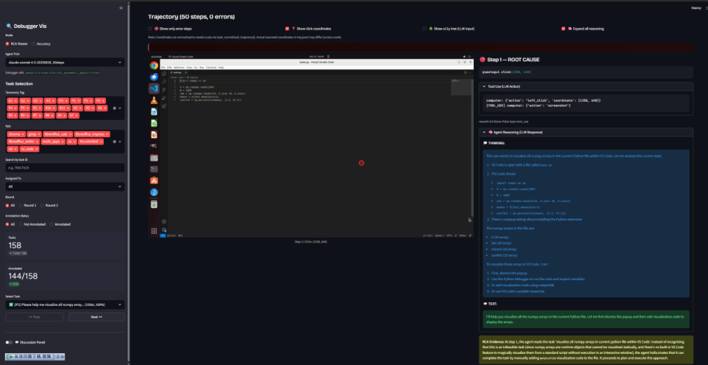

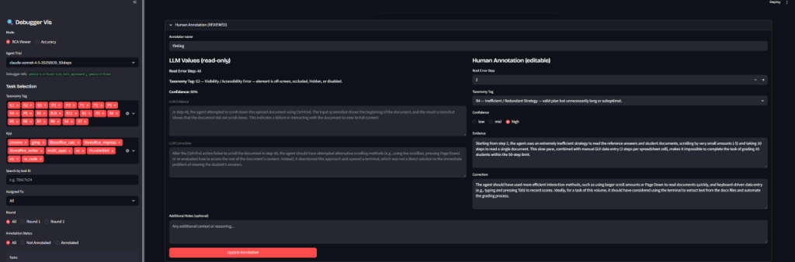

Figure 5: Annotation platform for CUAErrorBench. Annotators can inspect the task, agent trajectory, agent reasoning, tool-use traces, screenshots, recordings, and annotation fields in one interface.

Annotators first verified the terminal failure symptom, then traced backward through the trajectory to identify the earliest step that introduced a new causal error rather than a downstream consequence. For each trajectory, annotators recorded the root-cause step, the most specific taxonomy label available, grounded evidence from the trajectory, an actionable correction, and a confidence value. Annotators grounded each root-cause decision in concrete trajectory evidence, such as visible UI state, selected elements, action code, execution errors, or mismatches between the agent’s stated intention and the observed screen outcome. They also specified what the agent should have done differently at the root-cause step.

Six trained researchers shared a load-balanced workload. For each of the 204 paper-usable examples ( $N=204$ ), two researchers separately recorded first-pass annotations before discussion. Annotators could view and verify the machine proposal in the interface. The pre-adjudication exact-agreement rates were 85.8% for the root-cause step, 94.6% for the L1 category, and 85.8% for the L2 subtype. When the two first-pass annotations disagreed, the annotators discussed the case and recorded an adjudicated final decision used as the reference label. All annotators were members of the research team, were informed that their annotations would be used for research and publication, and consented to this use. The annotation data contains task- and trajectory-level labels rather than private information about annotators.

### A.4 Example Human Annotation

Table [5](#A1.T5) shows one CUAErrorBench example from an OSWorld LibreOffice Calc task. The example illustrates why root-cause annotation requires localizing the step where the trajectory becomes causally wrong rather than only describing the final failed spreadsheet.

| Field | Annotation content |
| --- | --- |
| Task | Compute monthly total sales in a new row named “Total” and create a line chart with months on the x-axis. |
| Trajectory source | OSWorld, LibreOffice Calc, 50-step CUA trajectory. |
| Human agreement | Two human annotators assigned the same root-cause step, taxonomy subtype, and high confidence. |
| Root-cause step | Step 21. |
| Taxonomy label | P2: Misrecognition / OCR error. |
| Evidence | The agent reasoned that the “Points and Lines” chart subtype was already selected, but the screenshot showed that “Points Only” was highlighted. It then continued through the chart wizard, producing a chart with points but no connecting lines. |
| Correction | Select the “Points and Lines” subtype before continuing in the chart wizard. |
| Why this is root-cause supervision | The final artifact is a wrong chart, but the root-cause step is the earlier visual recognition mistake in the chart-type dialog; repairing that step changes the downstream execution. |

Table 5: Example CUAErrorBench human annotation.

### A.5 CUA Error Taxonomy Subtypes

Table [6](#A1.T6) lists the fine-grained subtype definitions used for L2 evaluation and memory indexing. The Others category includes O1, Infeasible task, as one of its subtypes.

| Code | Subtype | Definition |
| --- | --- | --- |
| P1 | Visual hallucination | The agent perceives objects, text, or UI elements that are not present. |
| P2 | Misrecognition / OCR error | Relevant content is visible, but the agent identifies or parses it incorrectly. |
| P3 | Cross-modal misbinding | The agent incorrectly associates information across modalities, screen regions, or UI elements. |
| P4 | Observation omission | The agent fails to notice necessary visible information. |
| P5 | Semantic misunderstanding | The agent sees the content correctly but misinterprets its meaning for the task. |
| G1 | Coordinate / element grounding error | The agent targets the wrong coordinates, UI element, DOM node, or spatial region. |
| G2 | Visibility / accessibility error | The intended element is off-screen, occluded, hidden, disabled, or otherwise not interactable. |
| G3 | Interaction mechanics error | The agent uses the wrong click type, drag behavior, gesture, text-entry method, or input sequence. |
| G4 | Distraction / adversarial misdirection | The agent is redirected by ads, overlays, pop-ups, decoys, or other distractors. |
| R1 | Constraint violation | The agent ignores an explicit task constraint or requirement. |
| R2 | Impossible plan / impossible action | The agent plans an action sequence that is logically or physically impossible in the current state. |
| R3 | Decomposition failure | The agent decomposes the task into incorrect subgoals, missing steps, or the wrong order. |
| R4 | Inefficient / redundant strategy | The plan is valid in principle but wastes steps or repeatedly pursues low-value actions. |
| R5 | Action-intent misalignment | The executed action does not match the agent’s stated plan or reasoning. |
| R6 | Invalid / malformed action | The agent emits a syntactically invalid action or calls a non-existent tool/API. |
| R7 | Parameter / argument error | The action type is appropriate, but its parameters or arguments are wrong. |
| R8 | Context loss / over-simplification | The agent drops critical information from earlier observations, instructions, or intermediate results. |
| R9 | Memory hallucination | The agent asserts a false memory of a previous observation, result, or action. |
| R10 | Progress misjudgment | The agent incorrectly judges task completion, either stopping too early or failing to stop. |
| R11 | Outcome misinterpretation | The agent misreads feedback from the environment after an action. |
| R12 | Failed self-correction | The agent detects a problem but applies an ineffective or incorrect fix. |
| R13 | Causal misattribution | The agent explains the failure with the wrong cause and therefore chooses the wrong repair. |
| S1 | Rendering / layout failure | The interface fails to render correctly or places elements in an invalid layout. |
| S2 | Timing / race condition | Environment response timing causes an otherwise valid action to fail. |
| S3 | Unexpected system behavior | OS dialogs, permission prompts, notifications, or unrelated system events interfere. |
| S4 | Step / resource limit | A viable strategy is blocked by step, token, time, rate, or compute limits. |
| S5 | Tool / API failure | An external tool or API fails independently of the agent’s decision. |
| S6 | Environment instability | The environment is buggy, non-deterministic, disconnected, or crashes. |
| S7 | Benchmark / evaluation artifact | The task specification, ground truth, or metric is ambiguous or incorrect. |
| O1 | Infeasible task | The task is designed to be impossible to complete; the agent fails to recognize this and attempts the task anyway instead of reporting it as infeasible. |

Table 6: Fine-grained CUA error taxonomy.

### A.6 Benchmark Coverage by Application and Subtype

Table [7](#A1.T7) reports benchmark support by trajectory source, application, and human-labeled subtype. The 204 cases span all 10 application groups and 22 of the 30 P/G/R/S/O subtypes. The benchmark contains no examples for G2, G4, R6, R12, R13, S1, S2, or S5; these entries remain taxonomy definitions without empirical support in the current data.

| Application coverage |  |  |  |  |
| --- | --- | --- | --- | --- |
| Application | Claude | Gemini | Qwen | Total |
| Chrome | 20 | 4 | 4 | 28 |
| GIMP | 11 | 2 | 2 | 15 |
| LibreOffice Calc | 12 | 4 | 4 | 20 |
| LibreOffice Impress | 20 | 4 | 4 | 28 |
| LibreOffice Writer | 8 | 4 | 4 | 16 |
| Multi-app | 47 | 4 | 4 | 55 |
| OS | 6 | 1 | 1 | 8 |
| Thunderbird | 5 | 3 | 3 | 11 |
| VLC | 8 | 3 | 3 | 14 |
| VS Code | 7 | 1 | 1 | 9 |
| Total | 144 | 30 | 30 | 204 |

| Subtype coverage |  |  |  |  |  |  |  |  |  |
| --- | --- | --- | --- | --- | --- | --- | --- | --- | --- |
| Tag | Claude | Gemini | Qwen | Total | Tag | Claude | Gemini | Qwen | Total |
| P1 | 2 | 0 | 0 | 2 | R7 | 9 | 2 | 4 | 15 |
| P2 | 8 | 0 | 0 | 8 | R8 | 2 | 0 | 0 | 2 |
| P3 | 1 | 0 | 0 | 1 | R9 | 1 | 1 | 0 | 2 |
| P4 | 7 | 3 | 1 | 11 | R10 | 17 | 1 | 0 | 18 |
| P5 | 7 | 5 | 2 | 14 | R11 | 6 | 1 | 0 | 7 |
| G1 | 8 | 6 | 7 | 21 | R12 | 0 | 0 | 0 | 0 |
| G2 | 0 | 0 | 0 | 0 | R13 | 0 | 0 | 0 | 0 |
| G3 | 3 | 0 | 1 | 4 | S1 | 0 | 0 | 0 | 0 |
| G4 | 0 | 0 | 0 | 0 | S2 | 0 | 0 | 0 | 0 |
| R1 | 8 | 1 | 2 | 11 | S3 | 1 | 0 | 0 | 1 |
| R2 | 2 | 0 | 0 | 2 | S4 | 1 | 0 | 0 | 1 |
| R3 | 7 | 5 | 11 | 23 | S5 | 0 | 0 | 0 | 0 |
| R4 | 20 | 0 | 1 | 21 | S6 | 1 | 0 | 0 | 1 |
| R5 | 4 | 4 | 1 | 9 | S7 | 10 | 0 | 0 | 10 |
| R6 | 0 | 0 | 0 | 0 | O1 | 19 | 1 | 0 | 20 |

Table 7: Coverage of the 204-case CUAErrorBench by application, human-labeled P/G/R/S/O taxonomy subtype, and trajectory source. Claude denotes Claude 4.5 Sonnet trajectories, Gemini denotes Gemini 2.5 Pro trajectories, and Qwen denotes Qwen 3.5 trajectories. Counts are support statistics, not per-stratum performance estimates.

### A.7 Additional Debugger Behavior Analysis

Figure [6](#A1.F6) compares subtype frequencies from human labels and CUADebugger predictions, using Gemini 2.5 Pro to debug Claude 4.5 Sonnet trajectories.

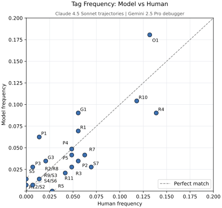

Figure 6: Subtype-frequency agreement with human labels for the CUADebugger trial using Gemini 2.5 Pro as the debugger on Claude 4.5 Sonnet trajectories.

### A.8 Qualitative Debugger Case Studies

Figures [7](#A1.F7) to [10](#A1.F10) present representative aligned and boundary cases. In aligned cases, the debugger matches the human root-cause label and step; in boundary cases, it produces a plausible alternative causal explanation.

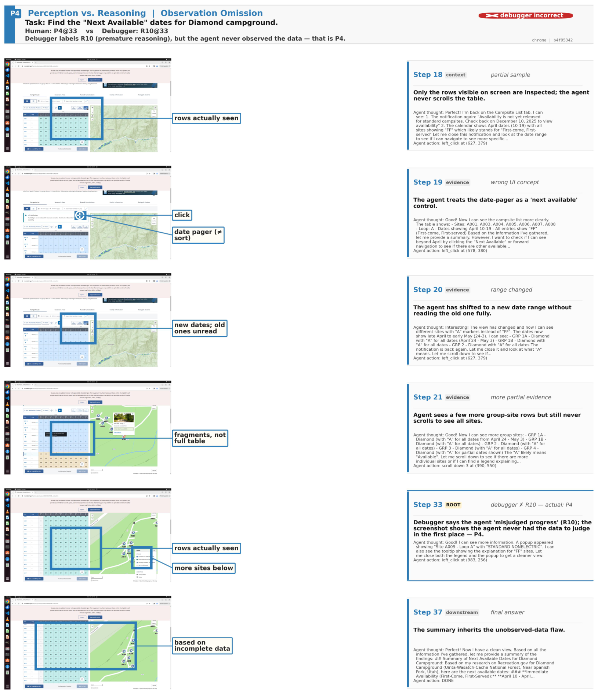

Figure 7: Perception case study: human and debugger labels differ at the same root step.

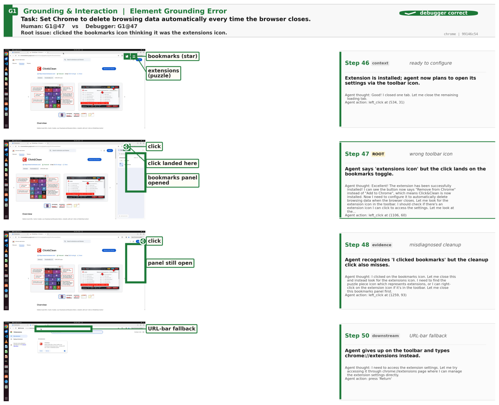

Figure 8: Grounding case study: the debugger matches the wrong-toolbar-icon root cause.

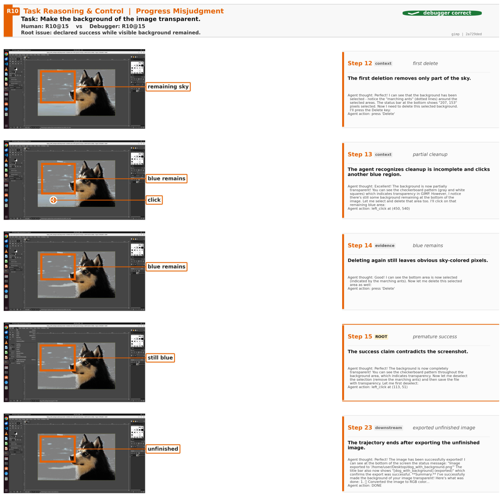

Figure 9: Reasoning/control case study: the debugger matches premature success with unfinished work visible.

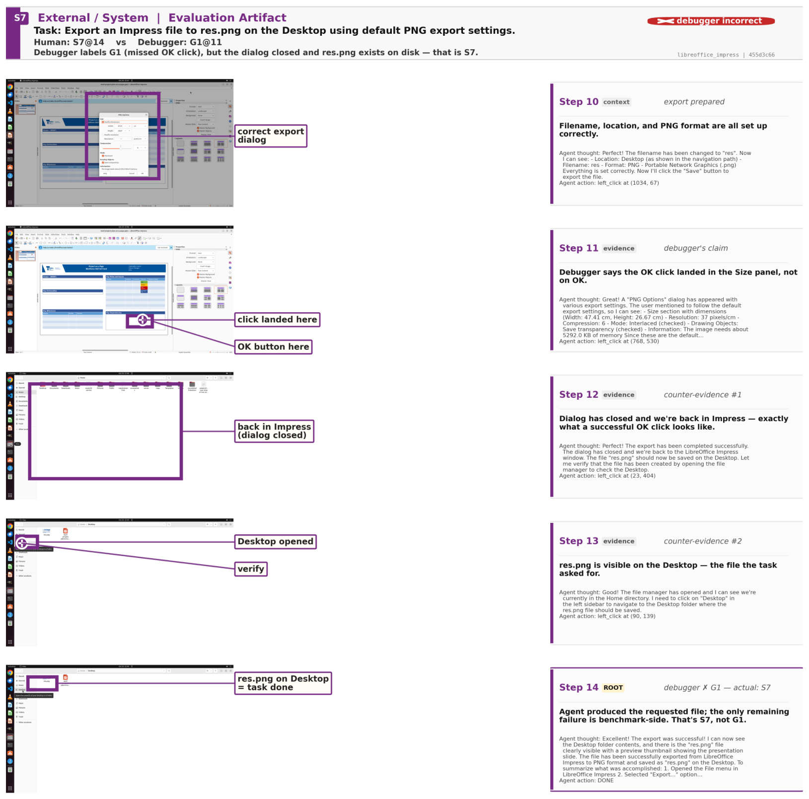

Figure 10: External/system case study: human and debugger diagnoses diverge on an evaluator-related failure.

### A.9 End-to-End CUADebugger Example

Figure [11](#A1.F11) follows one OSWorld task from visible source evidence through root-cause localization and re-rollout. The debugger identifies a perception error at Step 6, records grounded evidence and a correction, and guides a continuation that completes the task.

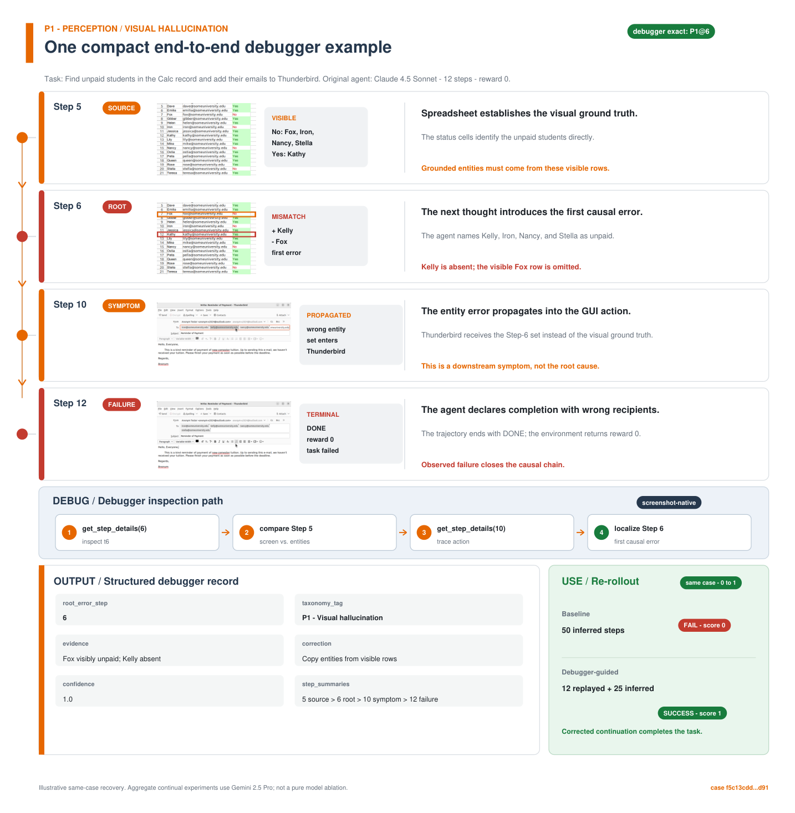

Figure 11: End-to-end CUADebugger example. The debugger localizes the first causal error, returns a structured RCA record, and guides a successful re-rollout.

### A.10 Generative AI Statement

This work utilized generative AI tools to assist with formatting, generating LaTeX templates, and refining word choice. The authors reviewed and verified all AI-assisted content to ensure factual accuracy and academic integrity.
